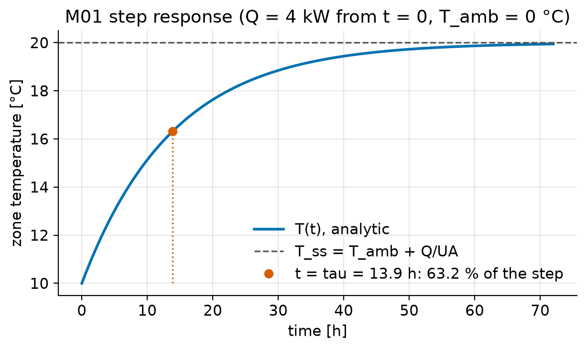
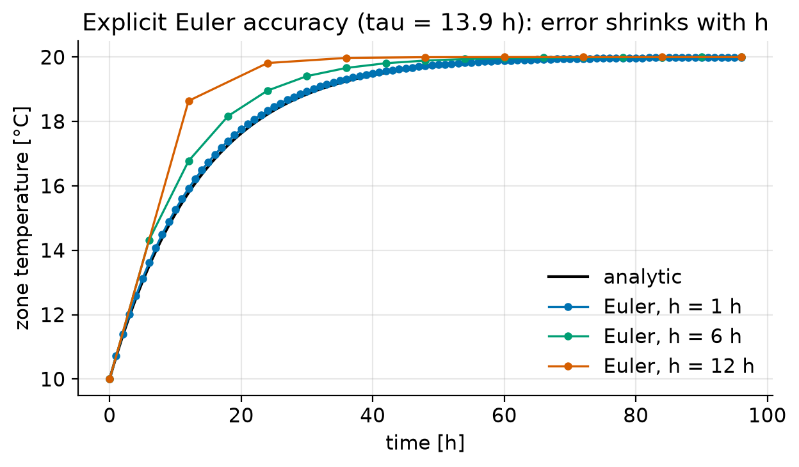
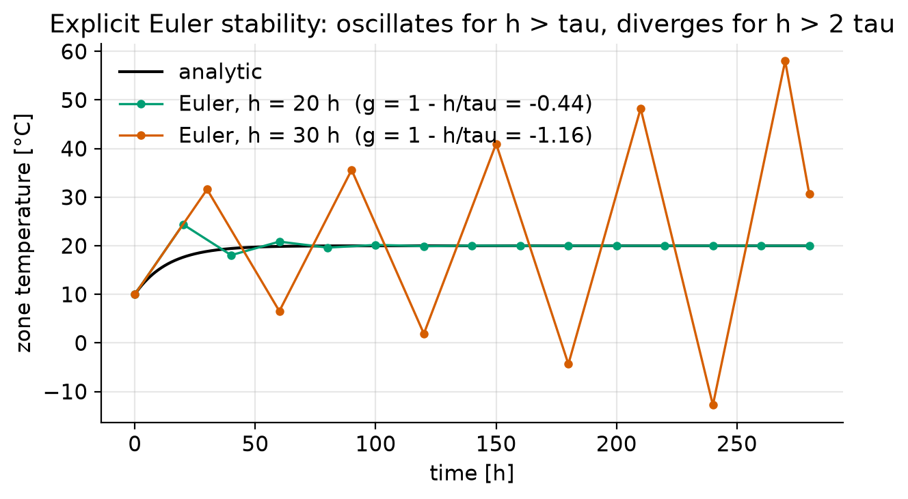
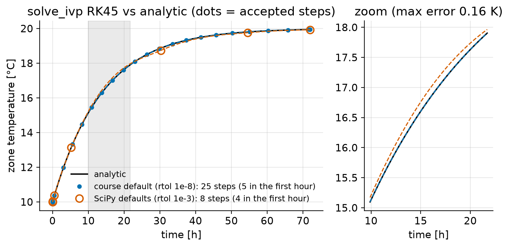
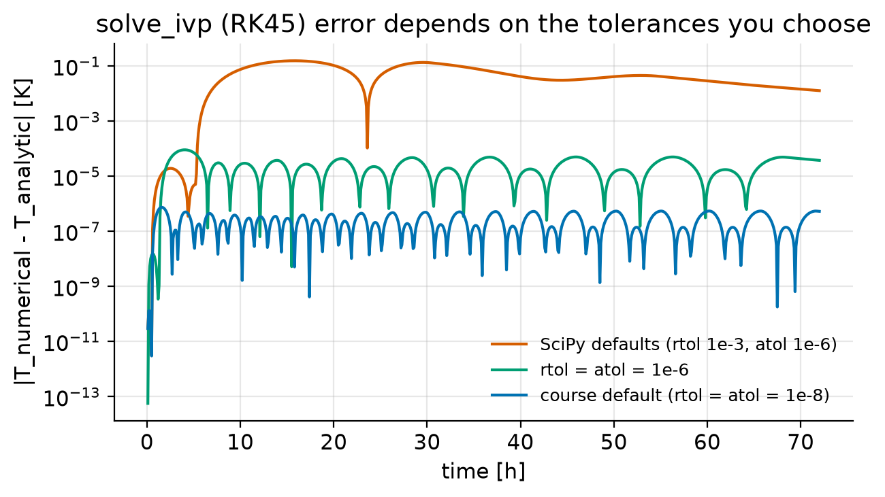
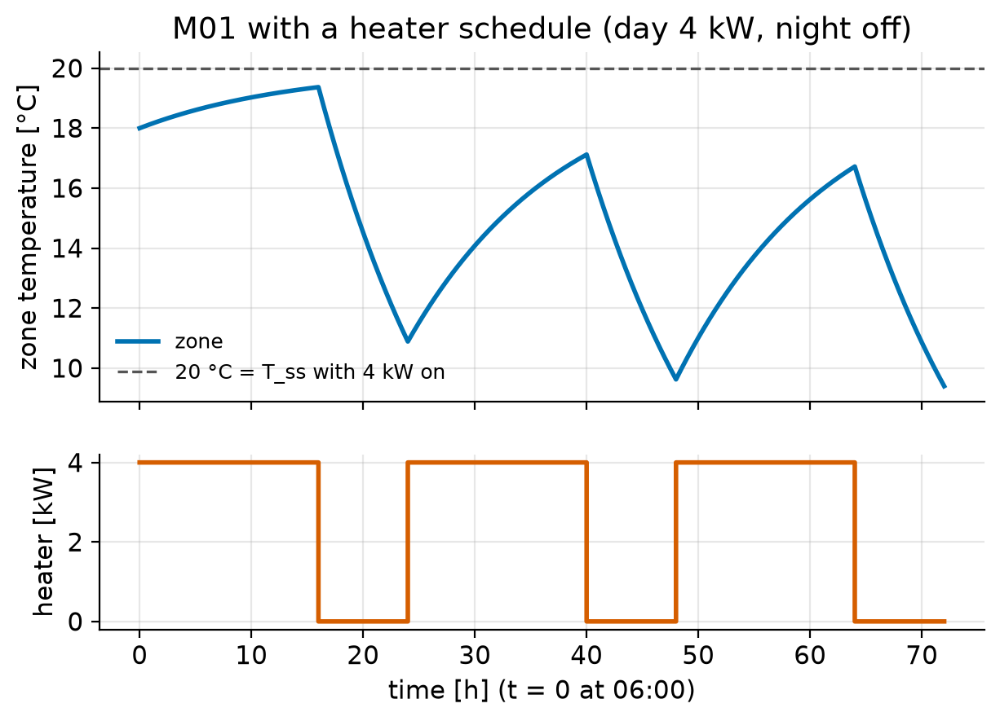

# Session 1 — Dynamic Systems Modelling Fundamentals

**Canonical model:** M01 `ThermalZone` · **Duration:** 150 min ([timetable](../../docs/syllabus.md#session-1--dynamic-systems-modelling-fundamentals)) ·
**Sources:** [source map](../../REFERENCES.md) · **Code:** `energy_training.simulation.thermal_zone`,
`energy_training.simulation.integrators` · **Notebook:** `python/notebooks/s01_thermal_zone.ipynb`

## 1. Learning objectives

After this session the participant can:

1. distinguish static and dynamic models and say when a dynamic model is needed;
2. identify states, inputs (manipulated and disturbance), outputs and parameters of a model;
3. derive the energy balance of a lumped thermal mass and write it as an ODE;
4. compute equilibrium temperature and time constant, and solve the step response analytically;
5. integrate the ODE numerically (explicit Euler by hand, `solve_ivp`) and judge accuracy and stability;
6. write the model in state-space form and recognise a DAE formulation of the same physics.

## 2. Prerequisite concepts

First-order linear ODEs; first law of thermodynamics (energy conservation); Session 0
(Python 101: environment, notebooks, NumPy, Matplotlib). See
[docs/prerequisites.md](../../docs/prerequisites.md).

**The case study.** The course follows one building from start to end: a single-family house
in Turin with space heating, hot water and electricity needs, served by a heat pump, a thermal
storage tank, PV, a battery and the grid. The final question (Sessions 7–8) is which sizes and
which operation cost least. Today the house is a single thermal mass (M01).

## 3. Source map

Summary below; full list of sources in [REFERENCES.md](../../REFERENCES.md).
Definitions of state and state-space models: `[src: astrom-murray-2021 Ch. 3]`. Solution of
linear ODEs: `[src: astrom-murray-2021 Ch. 5–6]`. Lumped capacitance: `[src: incropera]`.
`solve_ivp`: `[src: scipy-docs]`. Pre-reading for Session 3: `[src: modelica-by-example]`
*Basic Equations*.

## 4. Theory

### 4.1 Static vs dynamic

A **static** model relates inputs and outputs at the same instant (e.g. heat loss
$\dot Q_{loss} = UA\,(T - T_{amb})$ for a given $T$). A **dynamic** model contains memory: the
output now depends on the past because something is **stored** — here thermal energy. Whenever
the time scale of storage (hours for a building) is comparable to the time scale of the question
(a night set-back, heat-pump cycling, charging a storage tank), a dynamic model is needed.

### 4.2 States, inputs, outputs, parameters

The **state** summarises the past: with the state at $t_0$ and the inputs after $t_0$, the future
is determined `[src: astrom-murray-2021 Ch. 3]`. Practical test: a state appears under $d/dt$ and
needs an initial value.

| Role | M01 |
|------|-----|
| state | zone temperature $T$ |
| manipulated input | heater power $\dot Q$ |
| disturbance input | ambient temperature $T_{amb}$ |
| output | $T$ |
| parameters | heat capacity $C$, loss conductance $UA$ |

### 4.3 Lumped modelling

We treat the zone as one node at uniform temperature. For a homogeneous solid the usual criterion
is a Biot number $Bi \lesssim 0.1$ `[src: incropera]`; a building zone is not a homogeneous solid,
so here lumping is an **assumption** justified by the question we ask (hour-scale behaviour), and
Session 2 relaxes it.

## 5. Mathematical formulation

**System boundary:** zone envelope. **Assumptions:** A1 uniform $T$; A2 constant $C$;
A3 losses $UA\,(T-T_{amb})$ with constant $UA$; A4 ideal heater; A5 $\dot Q(t)$, $T_{amb}(t)$ given.

Energy balance of the node (stored = in − out) `[src: incropera]` (lumped capacitance):

$$C\,\frac{dT}{dt} = \dot Q(t) - UA\,\bigl(T - T_{amb}(t)\bigr), \qquad T(0) = T_0 .$$

**Equilibrium** ($dT/dt = 0$, constant inputs): $T_{ss} = T_{amb} + \dot Q/UA$.

**Time constant:** rewrite as $\tau\,\dot T = -(T - T_{ss})$ with $\tau = C/UA$.

**Step response** (constant inputs from $t = 0$) `[src: astrom-murray-2021 Ch. 5–6]`:

$$T(t) = T_{ss} + (T_0 - T_{ss})\,e^{-t/\tau}$$

63.2 % of the change is completed after $\tau$, 95.0 % after $3\tau$.

**State-space form** with $x = T$, $u = [\dot Q,\ T_{amb}]^\top$, $y = T$:

$$\dot x = \underbrace{\left[-\tfrac{UA}{C}\right]}_{A} x + \underbrace{\left[\tfrac{1}{C}\ \ \tfrac{UA}{C}\right]}_{B} u,
\qquad y = \underbrace{[1]}_{C_y} x + \underbrace{[0\ \ 0]}_{D} u$$

The eigenvalue of $A$ is $-1/\tau$: the time constant *is* the dynamics.

**Linearity and superposition.** Because the model is linear, the response to both inputs is the
sum of the responses to each input alone `[src: astrom-murray-2021 Ch. 6]`:
$T(t) - T_0 = \Delta T_{\dot Q}(t) + \Delta T_{T_{amb}}(t)$, where each part is computed with
the other input held at its initial value. That is why $B$ has two columns — one per input
channel. (Check it in the notebook by simulating $\dot Q$ alone, $T_{amb}$ alone, and both.)

**Preview: two states (M02, Session 2).** Splitting the building into *zone* (air and light
mass) and *envelope* gives two coupled energy balances, $x = [T_z,\ T_e]^\top$, a 2×2 matrix $A$ and two
eigenvalues — two time constants, a fast one and a slow one.

**DAE view (preview for Session 3).** Keep the loss as an unknown:
$C\dot T = \dot Q - \dot Q_{loss}$, $\;0 = \dot Q_{loss} - UA\,(T - T_{amb})$.
Two unknowns ($T$, $\dot Q_{loss}$), one differential and one algebraic equation. Modelica
receives models in this form and sorts them itself.

## 6. Guided example

Illustrative parameters (round numbers for a small house; **not sourced data**):
$C = 1.0\cdot10^7$ J/K, $UA = 200$ W/K → $\tau = 5\cdot10^4$ s ≈ 13.9 h; $T_{amb}$ = 0 °C,
$\dot Q$ = 4 kW → $T_{ss}$ = 20 °C; $T_0$ = 10 °C.

1. Compute $\tau$ and $T_{ss}$ by hand.
2. Implement `rhs(t, T)` and an explicit Euler loop with $h$ = 1 h; compare with the analytic solution.
3. Repeat with $h$ = 6, 12 h (accuracy) and 20, 30 h (stability). Predict the behaviour from
   $g = 1 - h/\tau$ before running. What happens at exactly $h = \tau$ ($g = 0$)?
4. Use `solve_ivp` with SciPy's default tolerances and with tight tolerances; plot the error.
5. Write $A, B, C_y, D$ and check $A x + B u$ against `rhs`.

## 7. Executable model/code

```python
from energy_training.simulation import thermal_zone as tz
from energy_training.utilities import celsius_to_kelvin

p = tz.ThermalZoneParams(C=1.0e7, UA=200.0)
T_amb, T0, Q = celsius_to_kelvin(0.0), celsius_to_kelvin(10.0), 4000.0
res = tz.simulate((0, 72 * 3600), T0, Q, T_amb, p)      # solve_ivp, rtol = atol = 1e-8
exact = tz.analytic_step(res.t, T0, Q, T_amb, p)
```

The integrator used in the guided example is `energy_training.simulation.integrators.explicit_euler`
(readable teaching code). Inputs that jump are passed as a schedule; the simulator restarts the
integration at every jump and holds the input constant inside each segment:

```python
from energy_training.simulation.inputs import piecewise_constant

H = 3600.0
q = piecewise_constant([0, 16 * H, 24 * H], [4000.0, 0.0, 4000.0])   # W, on/off/on
res = tz.simulate((0, 48 * H), T0, q, T_amb, p, t_eval=np.linspace(0, 48 * H, 577))
print(tz.energy_balance(res, p))   # stored, supplied, lost, residual [J]
```

Tests: `python/tests/test_thermal_zone.py`.

## 8. Results













## 9. Interpretation

- **Time constant.** 13.9 h means a heating system cannot change the zone temperature quickly;
  after a night set-back, recovery takes many hours unless the heater is oversized.
- **Equilibrium.** $T_{ss} - T_{amb} = \dot Q/UA$ does not depend on $C$. Heat capacity changes
  *how fast*, never *where to*.
- **Explicit Euler.** Error decreases proportionally to $h$ (first order). For $h > \tau$ the numerical
  solution oscillates although the physics cannot; for $h > 2\tau$ it diverges. A wrong-looking
  result can be a numerical artefact, not physics.
- **Tolerances.** With SciPy's default tolerances (rtol $10^{-3}$) RK45 takes only 8 steps over 72 h
  and the error reaches ~0.16 K here; with rtol $10^{-8}$ it takes 25 steps and the error is below
  $10^{-6}$ K —
  acceptable for some questions, not for verifying a model against an analytic result. Tolerance
  is a modelling decision.
- **Schedule.** With nights off, the zone falls to 10.9 °C, 9.6 °C and 9.4 °C at 06:00 on
  successive mornings, and peaks at 19.4, 17.1 and 16.7 °C at 22:00: with $\tau$ ≈ 14 h a 4 kW
  heater cannot recover an 8-hour heating break within the day, and the zone drifts colder. The model already answers a design question (heater size, set-back depth); Sessions 7–8
  turn such questions into costs and optimal sizes.

## 10. Guided exercise

[G1.1 — Step response and τ](../../exercises/session_01/G1.1_step_response.md)

## 11. Independent exercise

[I1.1 — Heater schedule and energy use](../../exercises/session_01/I1.1_heater_schedule.md)

## 12. Solutions

Solutions are added to the `solutions/` folder of this repository after the session.

## 13. Common errors

See [common_errors.md](common_errors.md).

## 14. Optional advanced topics

See [optional_topics.md](optional_topics.md).
