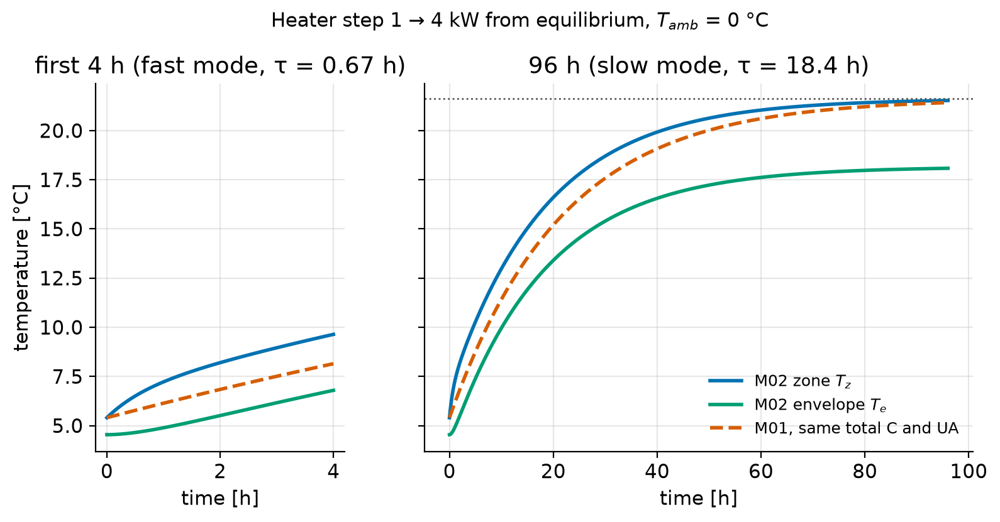
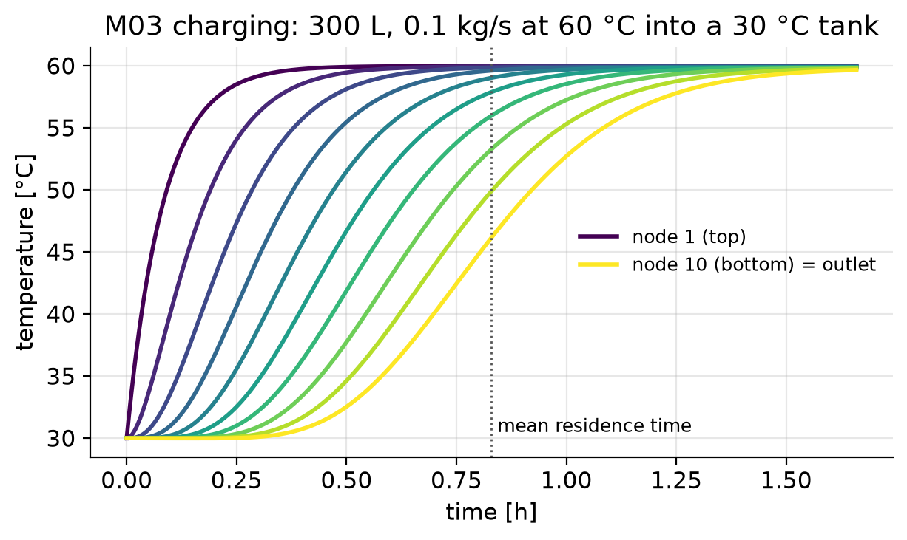
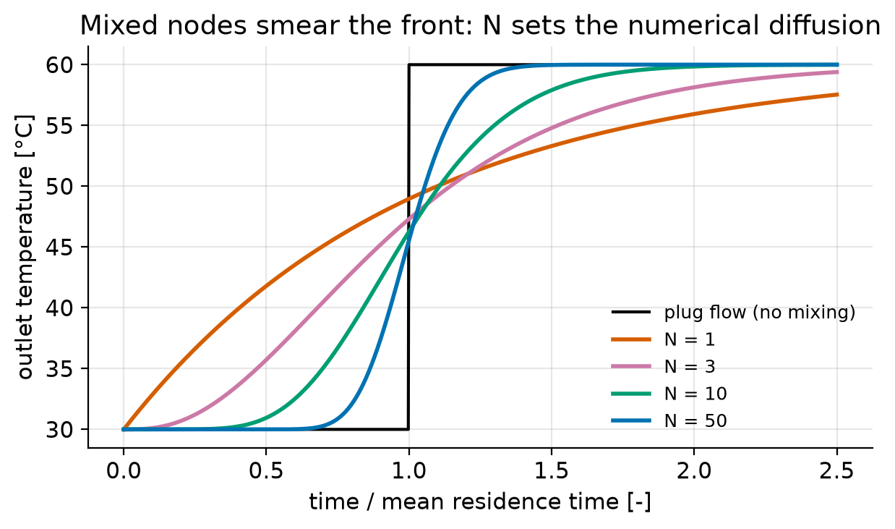
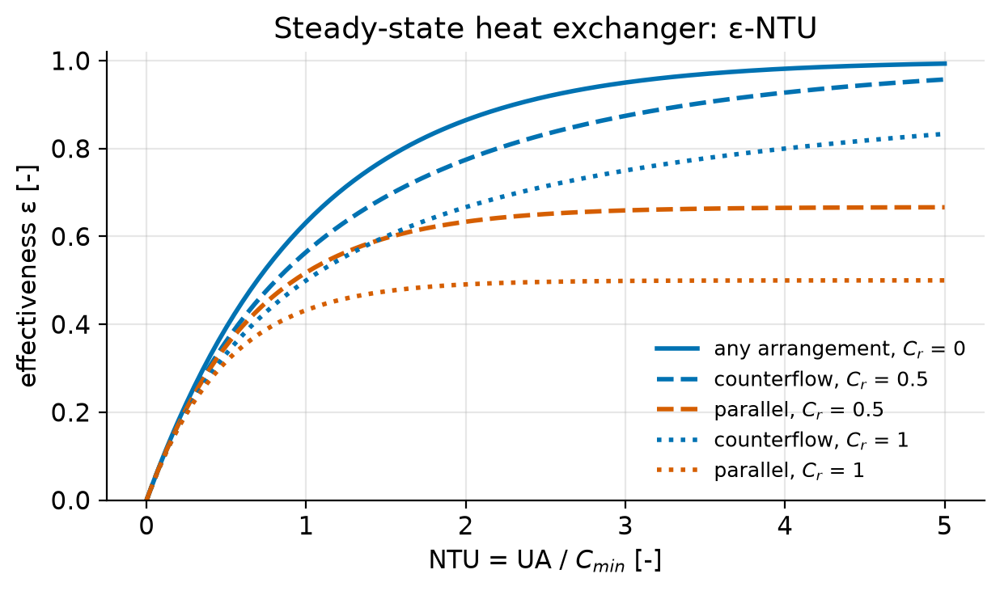

# Session 2 — Energy Systems Modelling Fundamentals

**Canonical models:** M02 `ZoneRC`, M03 `Storage` · **Duration:** 150 min ([timetable](../../docs/syllabus.md#session-2--energy-systems-modelling-fundamentals)) ·
**Sources:** [source map](../../REFERENCES.md) · **Code:** `energy_training.simulation.zone_rc`,
`storage`, `heat_exchanger` · **Notebook:** `python/notebooks/s02_rc_and_storage.ipynb`

## 1. Learning objectives

After this session the participant can:

1. write mass and energy balances for a control volume, including enthalpy flows, and state when
   $\dot m\,c_p\,(T_{in} - T_{out})$ is valid;
2. represent conduction, convection and linearised radiation as thermal resistances and build an
   RC network;
3. derive and simulate a two-node building model (M02), write its state-space matrices and read
   its time constants from the eigenvalues;
4. derive and simulate an N-node storage tank with a through-flow (M03) and verify its global
   energy balance numerically;
5. use a steady-state heat-exchanger model (ε-NTU) and judge when a steady-state component is
   acceptable inside a dynamic model;
6. explain how the number of nodes changes the dynamics (numerical diffusion, stiffness).

## 2. Prerequisite concepts

Session 1 (M01, time constant, `solve_ivp`, state-space form); first law of thermodynamics;
enthalpy; matrix eigenvalues. See [docs/prerequisites.md](../../docs/prerequisites.md).

## 3. Source map

Summary below; full list of sources in [REFERENCES.md](../../REFERENCES.md).
Control-volume energy balance, thermal resistances, linearised radiation, ε-NTU:
`[src: incropera]`. Two-node building model and its parameters: `[src: bacher-madsen-2011]`.
Representing a stratified tank by several fully mixed nodes: `[src: duffie-beckman-2013]`, `[src: buildings-14.0.0]`
(*Fluid.Storage* user's guide). Water properties: `[src: buildings-14.0.0]` (*Media.Water*).
Modes of linear systems: `[src: astrom-murray-2021 Ch. 6]`.

## 4. Theory

### 4.1 Conservation laws for a control volume

Choose a **control volume** and count what crosses its boundary. Mass: what flows in minus what
flows out accumulates. Energy: the rate of change of stored energy equals the enthalpy carried in
by mass flows, minus the enthalpy carried out, plus heat transferred in, minus work done
`[src: incropera]`. For liquid water with constant $c_p$ and no phase change, the enthalpy
difference is $c_p\,\Delta T$, so one inlet and one outlet with the same mass flow bring

$$\dot m\,c_p\,(T_{in} - T_{out}).$$

Only *differences* of enthalpy are physical: writing "$\dot m\,c_p\,T_{in}$ is the heat input" is
wrong unless the outflow term is also there.

> **Simplification:** the course uses constant water properties (`Buildings.Media.Water`:
> $\rho$ = 995.586 kg/m³, $c_p$ = 4184 J/(kg·K)) `[src: buildings-14.0.0]` and neglects kinetic,
> potential and pressure-work terms.

### 4.2 Heat transfer as resistances

Conduction through a layer ($R = L/kA$), convection at a surface ($R = 1/h_c A$) and radiation
linearised around a mean temperature ($h_r \approx 4\varepsilon\sigma T_m^3$, about
5 W/(m²·K) at room temperature for $\varepsilon$ = 0.9) all become **conductances** between two temperatures
`[src: incropera]`. Series resistances add; parallel conductances add. A lumped heat capacity is
a capacitor to ground. Every capacitor node gives one first-order ODE — the **electrical analogy**.

### 4.3 From one node to a network

M01 lumped the whole building into one node. Measured building data show at least two time
scales: the indoor air reacts within minutes to hours, the heavy envelope over a day. Grey-box
models of building heat dynamics are therefore RC networks with several nodes
`[src: bacher-madsen-2011]`. M02 is the smallest such network: zone and envelope.

### 4.4 Model fidelity

Each model is a choice of what to keep. Keep a state when its time scale matters for the question;
replace a fast component by a **steady-state** relation (no state) when its dynamics are much faster
than the time scales of interest. A heat exchanger with little water inside, inside a building model
that runs for days, is a typical steady-state component.

## 5. Mathematical formulation

### 5.1 M02 ZoneRC

**Boundary:** building envelope. **Assumptions:** two lumped nodes with constant capacities;
linear conductances zone–envelope ($R_{ze}$) and envelope–ambient ($R_{ea}$); heater on the zone
node; no solar gains.

$$C_z\frac{dT_z}{dt} = \frac{T_e - T_z}{R_{ze}} + \dot Q,\qquad
C_e\frac{dT_e}{dt} = \frac{T_z - T_e}{R_{ze}} + \frac{T_{amb} - T_e}{R_{ea}}$$

This is the deterministic part of the two-state model of Bacher & Madsen
`[src: bacher-madsen-2011]`. State space with $x = [T_z,\ T_e]^\top$, $u = [\dot Q,\ T_{amb}]^\top$:

$$A = \begin{bmatrix} -\frac{1}{R_{ze}C_z} & \frac{1}{R_{ze}C_z}\\ \frac{1}{R_{ze}C_e} & -\frac{1}{C_e}\left(\frac{1}{R_{ze}}+\frac{1}{R_{ea}}\right)\end{bmatrix},\qquad
B = \begin{bmatrix}\frac{1}{C_z} & 0\\ 0 & \frac{1}{R_{ea}C_e}\end{bmatrix}$$

**Equilibrium:** $T_z = T_{amb} + \dot Q\,(R_{ze} + R_{ea})$ — the two resistances in series.
**Modes:** the eigenvalues $\lambda_{1,2}$ of $A$ are real and negative; $\tau_i = -1/\lambda_i$.
The response to any input is a combination of the two modes `[src: astrom-murray-2021 Ch. 6]`.

### 5.2 M03 Storage

**Boundary:** tank wall. **Assumptions:** $N$ fully mixed layers of equal mass $m_k = \rho V/N$,
node 1 at the top `[src: buildings-14.0.0]`; the inflow always enters the end node and passes
through every layer (a course choice: other multi-node models let the inflow enter the layer
closest to its temperature); plug flow between layers; equal loss conductance
$UA_{loss}/N$ per layer; optional conduction $G$ between neighbours; no buoyancy correction.

Energy balance of node $k$, charging from the top ($T_0 \equiv T_{in}$) — the control-volume
balance of §4.1 applied to each layer:

$$m_k c_p \frac{dT_k}{dt} = \dot m\,c_p\,(T_{k-1} - T_k) + G\,(T_{k-1} - 2T_k + T_{k+1}) - \frac{UA_{loss}}{N}(T_k - T_{env})$$

(at the top and bottom node the missing neighbour drops out of the conduction term). Summed over
all nodes, the advection terms telescope to $\dot m\,c_p\,(T_{in} - T_N)$ and conduction cancels:

$$\frac{d}{dt}\sum_k m_k c_p T_k = \dot m\,c_p\,(T_{in} - T_{out}) - \sum_k \frac{UA_{loss}}{N}(T_k - T_{env}).$$

**Time scales:** mean residence time $\rho V/\dot m$; node time constant $\rho V/(N\dot m)$;
standby-loss time constant $\rho V c_p/UA_{loss}$.

### 5.3 Steady-state heat exchanger (ε-NTU)

$\dot Q = \varepsilon\,C_{min}\,(T_{h,in} - T_{c,in})$ with $C = \dot m c_p$, $NTU = UA/C_{min}$,
$C_r = C_{min}/C_{max}$ `[src: incropera]`:

$$\varepsilon_{parallel} = \frac{1 - e^{-NTU(1+C_r)}}{1 + C_r},\qquad
\varepsilon_{counter} = \frac{1 - e^{-NTU(1-C_r)}}{1 - C_r\,e^{-NTU(1-C_r)}}\quad(C_r < 1),\qquad
\varepsilon_{counter} = \frac{NTU}{1+NTU}\quad(C_r = 1).$$

## 6. Guided example

**M02** with the estimates for a 120 m² single-storey house `[src: bacher-madsen-2011]`:
$C_z$ = 1.07 kWh/K, $C_e$ = 2.92 kWh/K, $R_{ze}$ = 0.863 K/kW, $R_{ea}$ = 4.54 K/kW (one measured
house, an example rather than a typical value). Heater step 1 kW → 4 kW from equilibrium,
$T_{amb}$ = 0 °C.

**M03** with an illustrative 300 L tank, $N$ = 10, $UA_{loss}$ = 2 W/K, starting at 30 °C, charged
with 0.1 kg/s at 60 °C, surroundings at 20 °C.

## 7. Executable model/code

```python
from energy_training.simulation import storage as st, zone_rc as zr

p2 = zr.ZoneRCParams()                        # sourced defaults
print(zr.time_constants(p2) / 3600)          # [0.666, 18.37] h
res2 = zr.simulate((0, 96 * 3600), zr.steady_state(1000, 273.15, p2), 4000, 273.15, p2)

p3 = st.StorageParams()                       # 300 L, N = 10 (illustrative)
res3 = st.simulate((0, 3 * 3600), 303.15, 0.1, 333.15, 293.15, p3)
print(st.energy_balance(res3, p3))            # stored, advected, lost, residual [J]
```

Tests: `python/tests/test_zone_rc.py`, `test_storage.py`, `test_heat_exchanger.py`.

## 8. Results









## 9. Interpretation

- **Two time constants.** M02 has $\tau$ = 0.67 h and 18.4 h; the published values for the same
  parameters are 0.668 h and 18.4 h `[src: bacher-madsen-2011]` (their third, heater mode is
  dropped here). Which physical process each mode describes is the subject of I2.1.
- **M01 vs M02.** With the same total capacity and conductance, M01 has one time constant
  (21.6 h). Both models reach the same equilibrium, but along different paths: compare the first
  hours of the zone temperature in the figure.
- **Tank energy balance.** The residual of stored − (advected − lost) is about $10^{-8}$ of the
  throughput when the inflow has no jumps: the node equations conserve energy, and the
  conduction terms cancel exactly.
- **Number of nodes.** All $N$ give the same mean residence time (0.83 h here); larger $N$ gives a
  sharper front at the outlet. The smearing for small $N$ is **numerical diffusion** of the
  discretisation, not physics. Library tanks reduce it with higher-order corrections
  `[src: buildings-14.0.0]`.
- **Stiffness preview.** More nodes mean faster nodes (5 min for $N$ = 10) next to slow losses
  (174 h). Over one day an explicit solver needs about 28 times more right-hand-side calls for
  $N$ = 200 than for $N$ = 10; an implicit solver about 3 times (Session 4).
- **Heat exchanger.** Counterflow transfers more than parallel flow for the same $UA$
  (11.0 kW vs 7.5 kW in the notebook example) because the temperature difference stays larger
  along the exchanger.

## 10. Guided exercise

[G2.1 — Storage tank energy balance](../../exercises/session_02/G2.1_storage_energy_balance.md)

## 11. Independent exercise

[I2.1 — Dominant time constants of M02](../../exercises/session_02/I2.1_dominant_time_constants.md)

## 12. Solutions

Solutions are added to the `solutions/` folder of this repository after the session.

## 13. Common errors

See [common_errors.md](common_errors.md).

## 14. Optional advanced topics

See [optional_topics.md](optional_topics.md).
