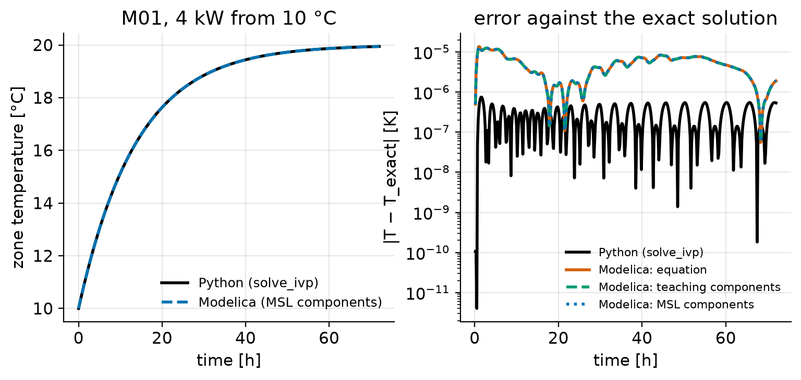
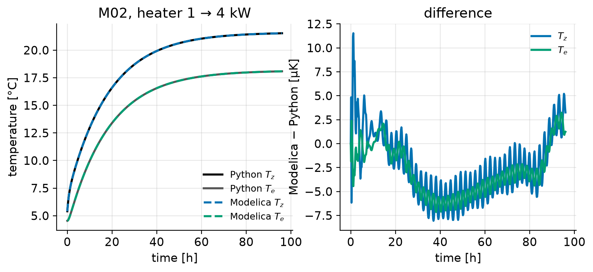

# Session 3 — Modelica Fundamentals

**Canonical models:** M01 `ThermalZone`, M02 `ZoneRC` in Modelica · **Duration:** 150 min ([timetable](../../docs/syllabus.md#session-3--modelica-fundamentals)) ·
**Sources:** [source map](../../REFERENCES.md) · **Code:** `modelica/EnergyTraining` (`Interfaces`,
`Components`, `Systems.ThermalZone`, `Systems.ZoneRC`, `Examples.S03_*`),
`energy_training.omc` · **Notebook:** `python/notebooks/s03_python_vs_modelica.ipynb`

## 1. Learning objectives

After this session the participant can:

1. explain the difference between assignment-based (causal) and equation-based (acausal)
   modelling, and what a Modelica compiler must do before a model can be simulated;
2. write a Modelica model with `parameter`, `Real`, `der()` and `initial equation`, simulate it in
   OMEdit and obtain the same result as the Python model of Session 1;
3. define a connector with a potential and a flow variable, and write the equations that
   `connect` generates;
4. compose a model from components, and replace teaching components by their Modelica Standard
   Library (MSL) equivalents after reading their source;
5. use `partial`, `extends`, `replaceable` and `redeclare` to change the structure of a model
   (M01 → M02) without rewriting it;
6. write `block`s with `RealInput`/`RealOutput` (simplified PV and battery) and connect them to
   time series.

## 2. Prerequisite concepts

Sessions 1–2 (M01, M02, state, energy balance of a node, RC networks); OpenModelica installed
with MSL 4.1.0 ([setup](../../SETUP.md)). Pre-reading: *Modelica by Example*,
*Basic Equations → Simple First Order System* `[src: modelica-by-example]`.

## 3. Source map

Summary below; full list of sources in [REFERENCES.md](../../REFERENCES.md).
Language semantics: `[src: modelica-spec-3.7]` (equations ch. 8, connectors ch. 9, classes ch. 4,
inheritance ch. 7, packages ch. 13). Tutorial: `[src: modelica-by-example]`. Library components:
`[src: msl-4.1.0]` (`Modelica.Thermal.HeatTransfer`). PV and battery equations of the library used
from Session 5: `[src: buildings-14.0.0]`. M02 parameters: `[src: bacher-madsen-2011]`.

## 4. Theory

### 4.1 Assignments and equations

In Python, M01 is a function that **computes** $\dot T$ from $T$ and the inputs: the modeller
decides which quantity is computed from which (a *causal* formulation). A Modelica model is a set
of **equations**: there is no order between them, and an equation states that two expressions are
equal, not that the left side is assigned `[src: modelica-spec-3.7 §8.3.1]`. Writing
`C*der(T) = Q_flow - UA*(T - T_amb)` or `Q_flow = C*der(T) + UA*(T - T_amb)` is the same model.

Before simulation the compiler must therefore **flatten** the model (replace every component by
its equations), **sort** the equations and **solve** each one for the variable it determines, so
that a numerical solver receives a causal form again. Session 4 shows these steps in
OpenModelica; today it is enough to know that they exist and that they are why components can be
written without knowing how they will be connected.

### 4.2 Causal and acausal composition

A **block diagram** connects outputs to inputs: information flows in one direction. A physical
**schematic** connects ports where several components share variables: a wall does not know
whether heat will flow in or out. Modelica supports both. Blocks (`block`) have only inputs and
outputs `[src: modelica-spec-3.7 §4.7]`; physical components have connectors without a direction.
*Modelica by Example* calls this second style *acausal* `[src: modelica-by-example]`.

### 4.3 Connectors: potential and flow

A connector lists the variables that two components share at a port. In the thermal domain these
are the temperature $T$ and the heat flow rate $\dot Q$ (`Q_flow`). `connect(a, b)` generates
`[src: modelica-spec-3.7 §9.2]`:

- for **non-flow (potential)** variables: equality, $T_a = T_b$;
- for **flow** variables (prefix `flow`): a zero sum, $\dot Q_a + \dot Q_b + \dots = 0$.

With the convention "flow positive *into* the component" (MSL `HeatPort`
`[src: msl-4.1.0]`), the zero sum is the energy balance of the connection point, which stores no
energy. *Modelica by Example* calls the two kinds *across* and *through* variables; a through
variable is the time derivative of a conserved quantity `[src: modelica-by-example]`. A flow
variable of a component's port left unconnected is set to zero `[src: modelica-spec-3.7 §9.2]`.

### 4.4 Classes, packages, inheritance

- **Specialized classes** `[src: modelica-spec-3.7 §4.7]`: `model` (general), `block` (inputs and
  outputs only), `connector` (no equations), `record` (data), `package` (a library of classes).
- **Packages** map to folders: `EnergyTraining/Components/ThermalMass.mo` starts with
  `within EnergyTraining.Components;` `[src: modelica-spec-3.7 §13.4]`; the optional `package.order`
  lists the classes in the order the library browser shows them `[src: modelica-spec-3.7 §13.4.1]`.
- **`extends`** inherits all elements and equations of a base class; modifiers change its
  parameters `[src: modelica-spec-3.7 §7.1]`.
- **`partial`** marks an incomplete class (for example, ports without equations); it can be a base
  class but cannot be simulated `[src: modelica-spec-3.7 §4.4.2]`.
- **`replaceable`** marks a component whose type can be changed later with **`redeclare`**; the
  replacement must be compatible with the **constraining type** (`constrainedby`)
  `[src: modelica-spec-3.7 §7.3]`. The constraining type is the plug every replacement must fit
  `[src: modelica-by-example]`.

### 4.5 Teaching components and library components

The course writes a component itself only when writing it is the lesson (today: `HeatPort`,
`ThermalMass`, `ThermalConductance`, `FixedTemperature`, `HeatSource`). After that it uses the
validated library: MSL `Modelica.Thermal.HeatTransfer` here, the Buildings library from Session 5.
Reading the library source is part of using it.

## 5. Mathematical formulation

### 5.1 M01 as one Modelica equation

```modelica
parameter Modelica.Units.SI.HeatCapacity C = 1.0e7 "illustrative";
parameter Modelica.Units.SI.ThermalConductance UA = 200 "illustrative";
Modelica.Units.SI.Temperature T;
initial equation
  T = T0;
equation
  C*der(T) = Q_flow - UA*(T - T_amb);
```

`der(T)` is the time derivative `[src: modelica-spec-3.7 §3.7.4]`. The initial condition is an
**initial equation**; alternatively `T(start = T0, fixed = true)` turns the start value into one
`[src: modelica-spec-3.7 §8.6]`.

### 5.2 Components and the generated equations

| Component | Equations |
|-----------|-----------|
| `ThermalMass` | $T = T_{port}$, $C\,\dot T = \dot Q_{port}$ |
| `ThermalConductance` | $\dot Q = G\,(T_a - T_b)$, $\dot Q_a = \dot Q$, $\dot Q_b = -\dot Q$ |
| `FixedTemperature` | $T_{port} = T_{fixed}$ |
| `HeatSource` | $\dot Q_{port} = -\dot Q_{in}$ (the heater delivers heat *out of* itself) |

At the node where heater, mass and conductance meet, `connect` adds
$T_{heater} = T_{mass} = T_{a}$ and $\dot Q_{heater} + \dot Q_{mass} + \dot Q_{a} = 0$. Eliminating
the trivial equations gives $C\,\dot T = \dot Q_{in} - G\,(T - T_{amb})$: M01 again.
The flattened model has as many unknowns as equations (14 each here); a simulation model must be
**balanced** `[src: modelica-spec-3.7 §4.8]`.

### 5.3 M02 by redeclaration

M01 (`Systems.ThermalZone`) has a replaceable heat path from zone to ambient:

```modelica
replaceable EnergyTraining.Components.EnvelopeUA envelope(final UA=UA)
  constrainedby EnergyTraining.Interfaces.PartialHeatPath;
```

M02 (`Systems.ZoneRC`) extends M01 and puts an envelope with heat capacity in its place:

```modelica
extends EnergyTraining.Systems.ThermalZone(
  final C=C_z, final UA=1/(R_ze + R_ea), final T_start=T_z_start,
  redeclare EnergyTraining.Components.EnvelopeRC envelope(
    final C_e=C_e, final R_ze=R_ze, final R_ea=R_ea, final T_e_start=T_e_start));
```

`EnvelopeRC` is conductance $1/R_{ze}$ – capacity $C_e$ – conductance $1/R_{ea}$; with the
connection equations it gives the two M02 equations of Session 2
`[src: bacher-madsen-2011]`. The number of states changes from 1 to 2; no connection changes.

### 5.4 Simplified PV and battery (I3.1)

PV: $P = A\,f_{act}\,\eta\,G_h$ (in the code the input keeps the Buildings name `G`); battery: $E_{max}\,\dot{SOC} = P_{act}$ with
$P_{act} = \eta_{cha}P$ for $P > 0$ (charging) and $P/\eta_{dis}$ otherwise. These are the
equations of the Buildings library components used from Session 5 (`PartialPV`, battery
`Charge`), which also do **not** keep $SOC$ in [0, 1] `[src: buildings-14.0.0]`.

> **Simplification:** in I3.1 the panel is horizontal (irradiance on the panel = $G_h$),
> without temperature or inverter losses; sizes and load are illustrative.

## 6. Guided example

1. **M01 as one equation** (`Examples.S03_ThermalZoneEquations`): the Session 1 guided example,
   $C$ = 10⁷ J/K and $UA$ = 200 W/K (illustrative), 4 kW from 10 °C at 0 °C outside, 72 h.
2. **M01 from teaching components** (`Examples.S03_ThermalZoneTeaching`), then **from MSL
   components** (`Systems.ThermalZone`, used by `Examples.S03_ThermalZoneMSL`): open
   `Modelica.Thermal.HeatTransfer.Components.HeatCapacitor` and compare it with `ThermalMass`.
3. **M02 by `extends` and `redeclare`** (`Systems.ZoneRC`, `Examples.S03_ZoneRCStep`): the
   Session 2 guided example, heater 1 → 4 kW from equilibrium, parameters of the 120 m² house
   `[src: bacher-madsen-2011]`.

## 7. Executable model/code

In OMEdit: *File → Open Model/Library File* `modelica/EnergyTraining/package.mo`, then simulate
the examples. From Python (local OpenModelica, or the course Docker image):

```python
from energy_training.omc.results import read_result
from energy_training.omc.runner import flatten, simulate

run = simulate("EnergyTraining.Examples.S03_ZoneRCStep", out_dir="output/s03")
df = read_result(run.csv)                       # time index [s], one column per variable
print(flatten("EnergyTraining.Examples.S03_ThermalZoneTeaching", out_dir="output/s03"))
```

Checks: `EnergyTraining.Validation.ThermalZoneForms` and `ZoneRCvsPython`, simulated with result
criteria by the course checks; `python/tests/test_omc.py`.

## 8. Results





## 9. Interpretation

- **Same model, same numbers.** M01 in Modelica differs from the exact solution by at most
  1.4·10⁻⁵ K over 72 h (OpenModelica's default solver DASSL, tolerance 10⁻⁸ from the `experiment`
  annotation); Python's RK45 at rtol = atol = 10⁻⁸ by 7.5·10⁻⁷ K. Both are integration errors, not
  model differences: tighten or loosen the tolerance and they change.
- **Three forms, one model.** The equation, the teaching components and the MSL components give
  identical results: after flattening and removing the trivial connection equations the compiler
  is left with the same differential equation.
- **M02.** The Modelica `ZoneRC` follows the Python M02 within 1.2·10⁻⁵ K ($T_z$) and 7·10⁻⁶ K
  ($T_e$) over 96 h. The redeclared envelope added a state; the zone, heater, ambient and their
  connections were reused unchanged.
- **What `connect` buys.** In Python each new node meant rewriting `rhs` and the state vector.
  In Modelica the node balance is generated by `connect`, so models grow by adding components.
- **Inputs and outputs.** Sources and sensors (`RealInput`, `RealOutput`) join the causal world of
  signals (weather, set points, controllers) to the acausal physical network. M06 in Session 6 is
  M05 with top-level inputs and outputs.

| | Python (Sessions 1–2) | Modelica (Session 3) |
|---|---|---|
| Model written as | right-hand side $\dot x = f(x, u)$ | equations, any order |
| Sorting and solving | by the modeller | by the compiler |
| Node energy balance | written by hand | generated by `connect` |
| M01 → M02 | new `rhs`, new state vector | one `redeclare` |
| Solver | `solve_ivp` (RK45, BDF, …) | DASSL by default (Session 4) |

## 10. Guided exercise

[G3.1 — M02 from library components](../../exercises/session_03/G3.1_zone_rc_composition.md)

## 11. Independent exercise

[I3.1 — Simplified PV and battery blocks](../../exercises/session_03/I3.1_pv_battery_blocks.md)

## 12. Solutions

Solutions are added to the `solutions/` folder of this repository after the session.

## 13. Common errors

See [common_errors.md](common_errors.md).

## 14. Optional advanced topics

See [optional_topics.md](optional_topics.md).
