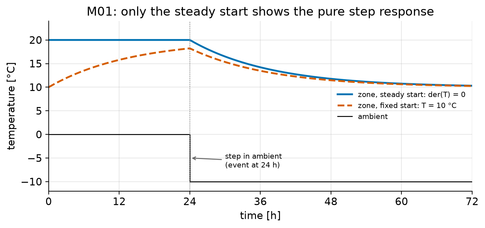
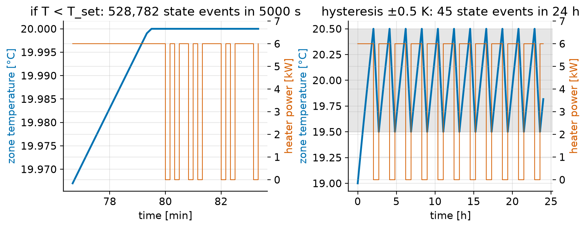
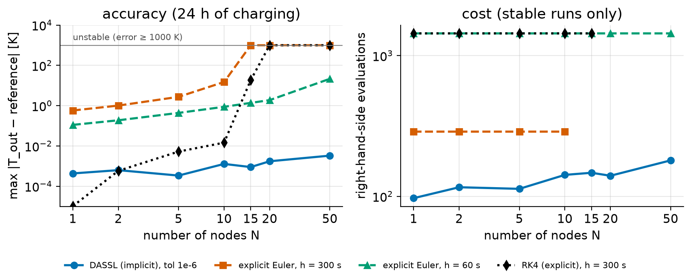

# Session 4 — OpenModelica Workflow and Numerical Modelling

**Canonical models:** M03 `StorageSystem` in Modelica; `EnergyTraining.Examples.Broken.*` ·
**Duration:** 150 min ([timetable](../../docs/syllabus.md#session-4--openmodelica-workflow-and-numerical-modelling)) ·
**Sources:** [source map](../../REFERENCES.md) · **Code:** `modelica/EnergyTraining`
(`Components.StorageTank`, `Systems.StorageSystem`, `Examples.S04_*`, `Examples.Broken`),
`energy_training.omc` (`runner`, `results`, `studies`) · **Notebook:**
`python/notebooks/s04_numerics_stiffness.ipynb`

## 1. Learning objectives

After this session the participant can:

1. describe what happens between a Modelica model and its simulation results: flattening,
   matching and sorting of the equations, algebraic loops and tearing, the number of states;
2. set up a simulation (stop time, output interval, solver, tolerance) and read the simulation
   log and its solver statistics;
3. state how many initial conditions a model needs, write them with `start`/`fixed` or
   `initial equation`, start a model in steady state so that the response to a disturbance is
   not mixed with an initial transient, and recognise under- and over-specified initialization
   in the log;
4. explain what an event is, distinguish time and state events, explain why an `if` does not
   protect a `sqrt` or a division from invalid arguments, why an ideal thermostat chatters, and
   write a hysteresis with `when`;
5. explain stiffness, choose between implicit and explicit solvers, and distinguish solver error
   (tolerance) from model error (number of nodes);
6. diagnose a failed or wrong simulation with a fixed checklist.

## 2. Prerequisite concepts

Sessions 1–3: M01–M03, explicit Euler and its stability limit $h < 2\tau$ for one mode (Session 1), node
count and numerical diffusion of M03 (Session 2), Modelica equations, connectors and the flat
model (Session 3). OpenModelica with MSL 4.1.0 installed ([setup](../../SETUP.md)).

**Pre-reading (about 45 min)**, *Modelica by Example* by M. Tiller, free online
`[src: modelica-by-example]`:

1. [Basic Equations → Initialization](https://mbe.modelica.university/behavior/equations/initialization/):
   one initial equation per state, and the general form of initial equations;
2. [Discrete Behavior → Cooling Revisited](https://mbe.modelica.university/behavior/discrete/cooling/):
   Newton's law of cooling (the structure of M01) with a disturbance at a given time, and a
   steady-state start;
3. [Discrete Behavior → State Event Handling](https://mbe.modelica.university/behavior/discrete/decay/):
   zero-crossing functions, why a guard `if x >= 0` still evaluates `sqrt(x)` for negative `x`,
   `noEvent`, chattering;
4. [Discrete Behavior → Hysteresis](https://mbe.modelica.university/behavior/discrete/hysteresis/):
   the chattering thermostat of exercise G4.1, and its hysteresis.

Optional: [Bouncing Ball](https://mbe.modelica.university/behavior/discrete/bouncing/) (state
events, `reinit`) and the review page [When](https://mbe.modelica.university/behavior/discrete/when/).
The book does not cover the solvers, stiffness or the OpenModelica tools: for those this lesson
follows the OpenModelica User's Guide. Book code written for MSL 3.2.2 needs `Modelica.SIunits`
renamed to `Modelica.Units.SI` (Session 3).

## 3. Source map

Summary below; full list of sources in [REFERENCES.md](../../REFERENCES.md).
Main tutorial for initialization and events: *Modelica by Example* `[src: modelica-by-example]`;
second tutorial: P. Fritzson's OpenModelica tutorial of the 2025 Modelica Conference
`[src: fritzson-tutorial-2025]` (cited by PDF page). Both are mapped to the lesson in the table
below. Language rules for initialization and events: `[src: modelica-spec-3.7]` (§8.3.5, §8.5, §8.6).
OpenModelica workflow, simulation flags, solvers and debugger: `[src: om-users-guide]`, and the
behaviour of OpenModelica 1.27.1 observed by running it `[src: om-release-1.27]`. Numerical
integration and stiffness: `[src: cellier-kofman-2006]`. Library components:
`[src: msl-4.1.0]`. M03 equations: Session 2 lesson §5.2.

| Lesson | *Modelica by Example* (https://mbe.modelica.university/…) | Fritzson tutorial (PDF page) | Specification 3.7 |
|--------|------------------------------------------------------------|------------------------------|-------------------|
| §4.1 from model to simulation | `behavior/equations/initialization/` (index reduction, in one paragraph) | 30 (translation), 126 (equation transformations) | §8.6 |
| §4.2 setup and log | – (OpenModelica User's Guide) | 129, 134 (debugger, chattering) | – |
| §4.3 initialization | `behavior/equations/initialization/`, `…/first_order/` (steady state) | – | §8.6, §8.6.1 |
| §4.3 steady start and disturbance | `behavior/discrete/cooling/` | – | §8.6 |
| §4.4 events | `behavior/discrete/cooling/`, `…/bouncing/`, `…/decay/`, `…/events/` | 164–166, 169 | §8.5 |
| §4.4 `when`, hysteresis | `behavior/discrete/hysteresis/`, `…/when/` | 166–167 | §8.3.5 |
| §4.5 stiffness | – (`behavior/arrays/oned/` derives a rod of N lumped nodes like M03, with conduction instead of advection) | – | – |

## 4. Theory

### 4.1 From model to simulation

Simulating a model in OMEdit has three phases `[src: om-users-guide]` (the pipeline from model
to flat hybrid DAE, sorted equations, C code and executable: `[src: fritzson-tutorial-2025 p. 30]`):

1. **Translation.** The front end *instantiates* the model into a flat list of variables and
   equations (Session 3). The back end analyses its structure and generates C code.
2. **Compilation** of the C code into a simulation executable.
3. **Simulation**: the executable computes the results. Re-simulating with changed parameter
   values repeats only this phase.

What the back end does with the flat equations:

- **Matching.** Each equation is assigned to the unknown it will compute. The derivatives
  `der(x)` of the states are unknowns; the states themselves are known at each instant, given
  by the integrator.
- **Sorting (BLT).** The equations are ordered so that each one only uses values already
  computed: a *block lower triangular* form. Most blocks are single assignments.
- **Algebraic loops.** A block of several equations that must be solved together. **Tearing**
  chooses a few *iteration variables*; the other unknowns of the block then follow one by one,
  and the remaining *residual* equations are solved for the iteration variables. A linear loop is
  solved directly; a nonlinear loop iteratively (Newton), starting from the **start values** of
  the iteration variables.
- **States and index.** Sometimes the equations constrain the states. Two heat capacities
  connected without a resistance must have the same temperature, so only one of them can be
  chosen freely. To obtain an ODE the tool may have to differentiate equations (**index
  reduction**) `[src: modelica-spec-3.7 §8.6]`, and it keeps fewer states than there are
  `der()` operators. So "every differentiated variable is a state" holds for an ODE, not for
  every model `[src: modelica-by-example behavior/equations/initialization/]`.

In this course's models the result is an ODE $\dot x = f(x, u, t)$ plus algebraic equations
evaluated along the way. The default solver integrates that ODE `[src: om-users-guide]`.

> **Simplification:** the matching, sorting and tearing algorithms themselves are not taught;
> the session uses only what the compiler reports about them (`[src: cellier-kofman-2006]` and
> `[src: fritzson-2014]` for the theory).

### 4.2 Simulation setup and log

| Setting | Meaning |
|---------|---------|
| start and stop time | simulated interval [s] |
| number of intervals, or interval | spacing of the output points; for **fixed-step** methods (`euler`, `rungekutta`) also the integration step `[src: om-users-guide]` |
| method | the integrator: `dassl` (default in 1.27.1), `ida`, `cvode`, `gbode`, `euler`, `rungekutta`, … |
| tolerance | error tolerance of the variable-step methods (default 1e-6) |

The values in a model's `experiment` annotation are used unless changed in the simulation
setup. With an adaptive method the output points are **interpolated** between the solver's own
steps: they do not force steps, and a small output interval does not make the result more
accurate `[src: om-users-guide]`.

**The log** says whether initialization and simulation succeeded, and lists warnings and errors.
More information is available with runtime flags (`-lv=LOG_STATS` for solver statistics,
`-lv=LOG_INIT` for initialization, `-lv=LOG_EVENTS` for events) and compiler flags
(`-d=initialization`) `[src: om-users-guide]`. OMEdit's **transformational debugger** shows the
equations after each transformation, with the variable each one solves for `[src: om-users-guide]`;
it also points to the equation whose zero crossing causes chattering
`[src: fritzson-tutorial-2025 pp. 126, 129]`.

### 4.3 Initialization

At the initial time the derivatives are unknowns too. An ODE with $n$ states and $m$ algebraic
unknowns has $2n + m$ unknowns at initialization but only $n + m$ equations, so it needs
**$n$ additional initial equations** `[src: modelica-spec-3.7 §8.6.1]`. They come from:

- `fixed = true` on a state's start value, which adds `x = start`;
- an `initial equation` section, for example `T = T0`, or `der(T) = 0` for a **steady-state**
  start.

`start` alone (with `fixed = false`, the default for variables) is only a guess for iterative
solvers `[src: modelica-spec-3.7 §8.6]`.

In general an initial equation is any relation $0 = h(x, \dot x, u, t_0)$ at the start time: a
value of a state, a value of a derivative, or a mix of both, one per state
`[src: modelica-by-example behavior/equations/initialization/]`.

**Steady start before a disturbance.** A study of how a building reacts to a cold front, a
heater failure or a change of set point wants the response to *that* disturbance alone. Started
at an arbitrary temperature, the model first relaxes towards its equilibrium, and this initial
transient overlaps the response. Starting with `der(T) = 0` puts the model in equilibrium with
the inputs at $t_0$, so the response to the disturbance is the only dynamics
`[src: modelica-by-example behavior/discrete/cooling/]`. `Examples.S04_SteadyStartStep` does
this for M01 (§5.4 and the figure in §8). The steady state belongs to the inputs at $t_0$: if they
change at once, the start is no longer an equilibrium.

A tool may treat a non-fixed start value as fixed, or remove a *consistent* redundant initial
equation, provided it reports a diagnostic `[src: modelica-spec-3.7 §8.6]`. OpenModelica 1.27.1
then warns:

- *The initial conditions are not fully specified*: a start value was used as an initial
  condition. If that start value is not set in the model, it is the default of the type, for
  example 288.15 K for `Modelica.Units.SI.Temperature` `[src: msl-4.1.0]`.
- *The initial conditions are over specified*: too many initial equations. If they contradict
  each other the simulation stops with *The initialization problem is inconsistent*.

### 4.4 Events

An expression such as `T < T_set` can change its value only at an **event**. During continuous
integration the solver keeps the value from the last event. When the underlying expression
`T - T_set` crosses zero, the integration is halted, the instant is located (root finding), the
relation and the equations that depend on it are updated, and the integration restarts
`[src: modelica-spec-3.7 §8.5]`. This keeps the equations smooth between events, as the
integrators require: their error control assumes smooth right-hand sides, so a jump inside a step
would only be found by trial and error, with rejected steps
`[src: modelica-by-example behavior/discrete/cooling/]`.

**Time and state events.** A condition on `time` alone (`time >= t_step`) can in principle be
scheduled in advance: a **time event**. A condition on the solution (`T < T_set`, `h < 0` for a
bouncing ball) must be located by root finding: a **state event**
`[src: modelica-by-example behavior/discrete/bouncing/]` `[src: fritzson-tutorial-2025 p. 166]`.
The specification leaves the scheduling of `time >= discrete expression` and
`time < discrete expression` to the quality of the implementation `[src: modelica-spec-3.7 §8.5]`. OpenModelica 1.27.1 treats the ambient step of
`Examples.S04_SteadyStartStep` (and the same step written with `>=` or with the MSL `Step` block)
as a state event: the statistics count 1 state event and 0 time events, and `-lv=LOG_EVENTS`
reports *state event at time=86400.0000173* (observed). Either way the integrator does not step
across the change.

**Zero crossings, and why a guard does not protect.** For `a > b` the compiler builds the
zero-crossing function `a - b`; the integrator watches its sign and, when it changes within a step,
interpolates to find the root `[src: modelica-by-example behavior/discrete/decay/]`. Until the event
is located, the equations of the **old branch** are still used, also at points beyond the crossing.
So `der(x) = if x >= 0 then -sqrt(x) else 0` still evaluates `sqrt` of a negative `x` while the
event is searched for. OpenModelica 1.27.1 stops this model (the book's `Decay2`) at $t$ = 2.0 s with
*Argument of sqrt(x) was … should be >= 0* (a tiny negative number, which depends on the
tolerance), exactly like the unguarded version (observed). `noEvent(...)` takes the relation literally, without an event, and fixes it. Use
`noEvent` only where the expression is continuous across the switch, as here; the book asks for a
smooth transition. Hiding a real jump costs the solver work: the
ambient step of `S04_SteadyStartStep` written with `noEvent` took 127 instead of 92 evaluations,
with 12 instead of 2 rejected steps (observed). The error was not larger here (8·10⁻⁴ K against 1.4·10⁻³ K): the book warns that the
effect of `noEvent` on accuracy cannot be predicted. The argument for events is the work, and the
safety of not stepping across a jump.

A `when` equation is active only at the instant its condition **becomes** true
`[src: modelica-spec-3.7 §8.3.5]`. Between those instants the variable keeps its previous
value, `pre(v)`. A **hysteresis** uses this: the heater switches off above $T_{set} + b/2$, on
below $T_{set} - b/2$, and keeps its state in between. The book writes the same rule with a vector
of conditions, `when {T > T_set + b/2, T < T_set - b/2} then heaterOn = T < T_set; end when;`,
which fires when **any** of them becomes true. In general this is not the same as `or`: `when a or
b` is one condition, which does not fire again while it stays true (for this thermostat both work,
because the condition is false inside the band)
`[src: modelica-by-example behavior/discrete/hysteresis/, behavior/discrete/bouncing/]`. Both forms
gave the same 45 state events and 22 switchings for the G4.1 thermostat (observed).

**Chattering.** With `Q_flow = if T < T_set then Q_max else 0` the zone warms up to $T_{set}$.
The heater switches off, $T$ falls, the relation is true again at once, and the heater switches
on. Every step is now an event. Physically the ideal thermostat switches infinitely fast.
Numerically, the solver crawls forward with tiny steps. This is the book's *ChatteringControl*
`[src: modelica-by-example behavior/discrete/hysteresis/]`; chattering also appears without any
controller, when the solution settles exactly at a switching point
`[src: modelica-by-example behavior/discrete/decay/]`.

### 4.5 Stiffness and solver choice

A model is **stiff** when an explicit method has to take steps much smaller than the accuracy of
the result would require, because larger steps are **unstable**. This happens when the model has
fast modes (short time constants) and is simulated over a time much longer than they are
`[src: cellier-kofman-2006]` (textbook section to be confirmed). The fast modes decay
quickly, but the explicit step stays limited by them: for explicit Euler on a single mode,
$h < 2\tau$ (Session 1). Above the limit the numerical solution grows without bound, even if
nothing physical happens on that time scale. **Implicit** methods such as
the BDF methods in DASSL, IDA and CVODE have no such limit for modes that decay without
oscillating, like those of M03: they take steps as large as the accuracy allows. In return each step solves an equation system with the
Jacobian matrix `[src: om-users-guide]`.

The **tolerance** of an adaptive method controls the error made in each step (local error),
not the error of the final result, which builds up over many steps (global error). Halving the
tolerance does not halve the error at the end. Measure it against a reference.

## 5. Mathematical formulation

### 5.1 Initial equations of M01 and M03

M01 has one state, so one initial equation: $T(0) = T_0$, or a steady start
$\dot T(0) = 0$, which gives $T(0) = T_{amb} + \dot Q/UA$. M03 with $N$ nodes has $N$ states:
`StorageTank` sets every node to `T_start` with `fixed = true`. A model with two states, such as
M02, needs two initial equations, one per state, whichever form they take (question for G4.1:
what is the equilibrium of the envelope node?).

### 5.2 Hysteresis

With band $b$ and heater state $s \in \{\text{on}, \text{off}\}$:

$$s \leftarrow \text{off when } T > T_{set} + b/2, \qquad s \leftarrow \text{on when } T < T_{set} - b/2,\qquad \dot Q = \begin{cases}\dot Q_{max} & s = \text{on}\\ 0 & s = \text{off}\end{cases}$$

```modelica
when T > T_set + bandwidth/2 then
  heaterOn = false;
elsewhen T < T_set - bandwidth/2 then
  heaterOn = true;
end when;
Q_flow = if heaterOn then Q_max else 0;
```

### 5.3 Stiffness of M03

With constant inflow, the Jacobian of M03 (Session 2, without conduction) is lower bidiagonal,
with $-(1/\tau_n + 1/\tau_{loss})$ on the diagonal and $1/\tau_n$ below it. The node time
constant is $\tau_n = \rho V/(N\dot m)$; the standby-loss time constant
$\tau_{loss} = \rho V c_p/UA_{loss}$ = 174 h only shifts the diagonal slightly. For the 300 L
tank at 0.1 kg/s, simulated for 24 h:

| $N$ | 1 | 10 | 50 |
|-----|---|----|----|
| $\tau_n$ | 2987 s | 299 s | 60 s |
| 24 h / $\tau_n$ | 29 | 289 | 1446 |

All eigenvalues are equal, so the eigenvalue limit of explicit Euler is $h < 2\tau_n$. For this
chain of nodes it is **not sufficient**. One Euler step maps the node temperatures with the
matrix $(1 - r)I + rS$, $r = h/\tau_n$, $S$ = shift to the next node (losses neglected). Its
maximum-row-sum norm is $|1 - r| + r$, which is at most 1 only for $r \le 1$: **$h \le \tau_n$**
(the Courant condition of upwind advection). For $\tau_n < h < 2\tau_n$ errors are passed down the
chain of nodes and grow before they decay (derived here; observed below).

### 5.4 Steady start and ambient step of M01

`Examples.S04_SteadyStartStep`: $C$ = 10⁷ J/K, $UA$ = 200 W/K, $\dot Q$ = 4 kW (Session 1),
$\tau = C/UA$ = 13.9 h; ambient 0 °C, then −10 °C from $t_s$ = 24 h. The steady start
$\dot T(0) = 0$ gives

$$0 = \dot Q - UA\,(T(0) - T_{amb,1}) \quad\Rightarrow\quad T(0) = T_{amb,1} + \dot Q/UA = 20\ ^\circ\mathrm{C},$$

and after the step the zone relaxes to the new equilibrium $T_{ss,2} = T_{amb,2} + \dot Q/UA$ = 10 °C:

$$T(t) = T_{ss,2} + (T_{ss,1} - T_{ss,2})\,e^{-(t - t_s)/\tau}, \qquad t \ge t_s .$$

The same zone started at $T_0$ = 10 °C is still at
$20 - 10\,e^{-24/13.9}$ = 18.2 °C when the step comes: its response mixes the initial transient
with the disturbance. `Validation.SteadyStartStep` compares both with these formulas.

## 6. Guided example

1. **From equations to code** (notebook §1, OMEdit): M03 with $N$ = 10
   (`Examples.S04_StorageCharging`) has 37 equations, 10 states and no algebraic loop. Then
   `Examples.S04_AlgebraicLoops` (a two-layer wall without heat capacity, and a radiating wall)
   and `Examples.S04_TwoCapacities` (two capacities at one temperature).
2. **Simulation setup and log**: one simulation of M03 in OMEdit with `-lv=LOG_STATS`; change only
   the output interval. Solvers and tolerances: notebook §2.
3. **Initialization**: count the initial equations of M01, M02, M03. In `S04_TwoCapacities`,
   fix the start value of the second capacity as well and read the error.
4. **Steady start and a time-dependent disturbance**: `Examples.S04_SteadyStartStep`. Predict
   $T(0)$ of the steady start and the temperature at the step of the fixed start (§5.4), then
   simulate with `-lv=LOG_STATS` and count the events.
5. **Events**: the thermostat with and without hysteresis (figure below). The models themselves
   are in exercise G4.1.
6. **Stiffness**: M03 with $N$ = 1 … 50 and four solver settings (notebook §3).

## 7. Executable model/code

In OMEdit: *File → Open Model/Library File* `modelica/EnergyTraining/package.mo`. From Python:

```python
from energy_training.omc.runner import backend_info, simulate_variant

print(backend_info("EnergyTraining.Examples.S04_AlgebraicLoops", out_dir="output/s04"))
run = simulate_variant("EnergyTraining.Examples.S04_StorageCharging", {"N": 50},
                       out_dir="output/s04", stop_time=86400, interval=60, method="euler")
run.stats            # steps, f_calls, state_events, cpu_time, ...
run.result["storage.T_out"]
```

`backend_info` translates with the compiler flags `-d=backenddaeinfo,dumpLoops`;
`simulate_variant` compiles a variant with changed parameters (also array sizes such as `N`) and
returns result and statistics (`-lv=LOG_STATS`). Checks: `EnergyTraining.Validation.StorageVsPython`
(M03 in Modelica against Python, < 1e-4 K), `EnergyTraining.Validation.SteadyStartStep` (§5.4
against its analytic solution, < 1e-4 K), `python/tests/test_omc.py`.

## 8. Results







## 9. Interpretation

- **What the compiler reports.** M03 with 10 nodes: 10 states, 21 single assignments, no loop;
  each node equation is solved for its derivative. The two-layer wall gives a **linear** torn
  system with one iteration variable (the temperature between the layers) and three inner
  variables. The radiating wall gives a **nonlinear** one, solved by Newton from the start value
  288.15 K. The two directly connected capacities give **one** state; fixing both start values
  makes OpenModelica 1.27.1 stop with *alias variables with conflicting fixed start values*.
- **Statistics.** M03 ($N$ = 10, 3 h, DASSL, tolerance 1e-6): 109 steps, 134 right-hand-side
  evaluations, 16 Jacobians, a few milliseconds of computing time. The 180 output points do
  not force steps.
- **Steady start.** `S04_SteadyStartStep` starts at 20.0000 °C and stays there until the step;
  its response is the pure step response of §5.4. The fixed start meets the step at 18.2 °C and
  never shows it alone. The step costs one event (counted as a state event by OpenModelica
  1.27.1, §4.4): 70 steps for 72 h with DASSL at tolerance 1e-6.
- **Events.** The ideal thermostat produced 528 782 state events in 5000 s, and OpenModelica
  reported *Chattering detected around time 4764.8 … The zero-crossing was: T < T_set*. With a
  ±0.5 K hysteresis a whole day needs 45 state events and 22 switchings. Every crossing of a
  threshold is an event, including the crossings that change nothing.
- **Stiffness.** Over 24 h of charging, explicit Euler with $h$ = 300 s is wrong by 15 K at
  $N$ = 10 ($h \approx \tau_n$) and by 2·10⁷ K at $N$ = 15, although $h < 2\tau_n$ there: the
  eigenvalue limit alone does not predict the failure, $h \le \tau_n$ does. Classical
  Runge–Kutta (RK4), with a larger stability interval for a single mode, is wrong by 19 K at
  $N$ = 15 and blows up at $N$ = 20. With $h$ = 60 s Euler stays bounded up to $N$ = 50 but is wrong by up to 22 K.
  DASSL stays within 0.3–3·10⁻³ K for every $N$ with 97–180 evaluations, fewer than any
  explicit setting.
- **Which error matters?** With the default tolerance the solver error of M03 is about 10⁻³ K.
  The difference between $N$ = 10 and $N$ = 50 is several kelvin at the outlet (Session 2,
  numerical diffusion). For this model the number of nodes, a modelling choice, matters far more
  than the tolerance. Exercise I4.1 quantifies both.

### Debugging checklist

A failed or suspicious simulation is a **modelling question first**. Check, in this order:

1. **Formulation**: equations, signs, units; is the model balanced (*Check Model*)?
2. **Initialization**: one initial condition per state; warnings about unspecified or
   over-specified initial conditions; start values of the iteration variables of nonlinear
   loops.
3. **Scaling**: variables of very different magnitude (W and MW, Pa and bar). Nominal values.
4. **Algebraic loops**: their number and size (`-d=backenddaeinfo`); a division by a variable
   that can become zero.
5. **Discontinuities and events**: number of state events (`-lv=LOG_STATS`); chattering; a
   relation that compares with exactly the value a variable jumps to; an `if` that should guard
   a `sqrt`, a `log` or a division (it does not: §4.4).
6. **Stiffness**: explicit solver, or a step size near the stability limit.
7. **Constraints**: `min`/`max` violations reported as assertions. A temperature below 0 K is
   usually a symptom of the problems above, not their cause.
8. **Solver configuration**: method, tolerance, maximum step, last.

## 10. Guided exercise

[G4.1 — Diagnose and fix broken models](../../exercises/session_04/G4.1_broken_models.md)

## 11. Independent exercise

[I4.1 — Convergence study on M03](../../exercises/session_04/I4.1_convergence_study.md)

## 12. Solutions

Solutions are added to the `solutions/` folder of this repository after the session.

## 13. Common errors

See [common_errors.md](common_errors.md).

## 14. Optional advanced topics

See [optional_topics.md](optional_topics.md).
