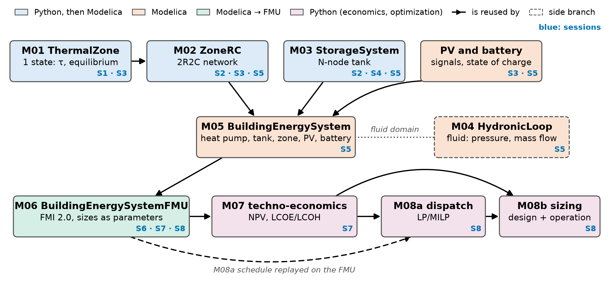

# Canonical model lineage

One building is followed through the whole course: a single-family house in Turin with thermal
demand (space heating, hot water) and electrical demand (appliances), served by a heat pump, a
thermal storage tank, rooftop PV, a battery and the grid. Each session adds one piece, until
Sessions 7–8 ask which sizes and which operation minimise the total cost.
Each model **reuses** its predecessor; none is created only because a lesson "needs code".



*Arrows mean "is reused by" (column* Reuses *in the table below); the blue labels are the sessions that use each model.*

## Models

| ID | Name | Implementation | Session(s) | New concept | Reuses |
|----|------|----------------|-----------|-------------|--------|
| M01 | `ThermalZone` | Python `simulation.thermal_zone`; Modelica `Systems.ThermalZone` | 1, 3 | state, τ, equilibrium | – |
| M02 | `ZoneRC` | Python `simulation.zone_rc`; Modelica `Systems.ZoneRC` | 2, 3, 5 | multiple states, RC network, composition | M01 components |
| M03 | `StorageSystem` | Python `simulation.storage`; Modelica `Systems.StorageSystem` | 2, 4, 5 | open-system energy balance, N nodes, stiffness | `Components.StorageTank` |
| – | PV and battery | S3: participant's simplified components (I3.1, language exercise); S5 onward: Buildings `Electrical.AC.OnePhase` `PVSimpleOriented`, `Storage.Battery`, `Loads.Resistive`, `Sources.Grid` | 3, 5 | S3 inputs/outputs, state of charge; S5 library use | – |
| M04 | `HydronicLoop` | Modelica `Systems.Hydronic.HydronicLoop` (Buildings) | 5 | fluid connectors, pressure/flow, library use | – (fluid branch) |
| M05 | `BuildingEnergySystem` | Modelica `Systems.BuildingEnergySystem` | 5 | heat pump COP, system assembly, library electrical network, rule-based operation | M02, M03, `CarnotHeatPump`, Buildings PV/battery/grid and weather reader, `Controls.*` |
| M06 | `BuildingEnergySystemFMU` | Modelica → FMU (FMI 2.0 ME+CS); sizes as parameters; operating-mode switch (rules / external) with heat-pump and battery command inputs | 6, 7, 8 | FMU interface, scenario simulation | M05 |
| M07 | techno-economic assessment | Python `economics` | 7 | CAPEX/OPEX, NPV, LCOE/LCOH, sensitivity, design sweep | M06 results |
| M08a | dispatch | Python `optimization.dispatch` | 8 | LP/MILP, linear surrogate, model mismatch | M07 costs, M06 for replay |
| M08b | sizing | Python `optimization.sizing` | 8 | joint design + operation MILP | M08a, M07 |

**Why M04 is a side branch:** the fluid domain (pressure, mass flow, stream variables) is taught
with library components on a small loop. Carrying the whole system into the fluid domain would
make M05–M06 slower, harder to initialise and fragile as an FMU across platforms.
M05 onward stays in the thermal domain with the mass flow as a
prescribed variable; the lesson explicitly shows how M05 maps to a Buildings-based fluid
implementation (`Buildings.Fluid.HeatPumps.Carnot_y`, verified in Buildings 14.0.0).
The electrical side (PV, battery, appliances, heat-pump electricity, grid) uses the Buildings
single-phase AC components on an ideal bus whose voltage is imposed by the grid. Voltages and
currents are not studied; the cost question uses only real power (grid import/export, PV
output). Weather comes from the Buildings reader with a course-written file
(`energy_training.data.weather.write_buildings_mos`).

## Parameters and their status

| Quantity | Value | Status |
|----------|-------|--------|
| M02 $C_z$, $C_e$, $R_{ze}$, $R_{ea}$ | 1.07 and 2.92 kWh/K; 0.863 and 4.54 K/kW (120 m² house) | sourced: `bacher-madsen-2011` Table 3 |
| Zone heat capacity $C$ (M01) | 1e7 J/K, illustrative (the sourced M02 house totals 1.44e7 J/K) | illustrative |
| Zone $UA$ (M01) | 200 W/K, illustrative (the sourced M02 house: 185 W/K) | illustrative |
| Water $\rho$, $c_p$ | 995.586 kg/m³, 4184 J/(kg·K) | sourced: `buildings-14.0.0` Media.Water |
| Storage volume | 300–1000 L water | needs source |
| Tank $UA_{loss}$ | ~1–3 W/K | needs source |
| Heat pump nominal heating power | 5–8 kW | needs source |
| Carnot fraction $\eta_C$ | ~0.4–0.5 | needs source |
| Weather (Turin) | typical meteorological year, hourly | `pvgis-5.3` (TMY downloaded 2026-11-19; `energy_training.data.weather`) |
| PV yield (Turin) | Buildings `PVSimpleOriented` on the TMY (spike: 1794 kWh/kWp with 96 % inverter, no other losses) | model chosen (Buildings `PVSimpleOriented`); effective losses need source |
| Demand profiles (hot water, appliances) | hourly profiles | needs source |
| Electricity tariffs, feed-in price | Italian tariff components | needs source (candidates: ARERA, GME) |
| Investment cost, O&M, lifetime (HP, PV, tank, battery) | per kW, kWp, L, kWh | needs source (candidate: Danish Energy Agency technology data) |
| Battery round-trip efficiency, PV system losses | – | needs source |
| Discount rate, analysis period | – | course choice, varied in S7 sensitivity |

No parameter value is used in teaching material until it is backed by a registered source
or explicitly labelled as illustrative.

## Session dependency map

```
S0 ──► S1 ──► S2 ──► S3 ──► S4 ──► S5 ──► S6 ──► S7 ──► S8
        │      │      ▲      ▲      ▲      ▲      ▲      ▲
        │      └──────┘      │      │      │      │      │
        └── M01 reused in S3 │      │      │      │      │
               M03 reused in S4      │      │      │      │
               M02 + M03 + S3 PV/battery reused in S5 (M05)
                                     S5 inputs/outputs define the S6 FMU
                                            S6 scenario runner feeds S7 economics
                                                   S7 costs and S6 FMU are used in S8
```

Hard dependencies: S1 needs the S0 environment; S3 needs S1–S2 equations; S4 needs S3 syntax;
S5 needs S3 connectors and components and S4 debugging; S6 needs M05; S7 needs the S6 scenario
runner; S8 needs the S7 cost model and the M06 FMU. Consequence: sessions cannot be reordered.
