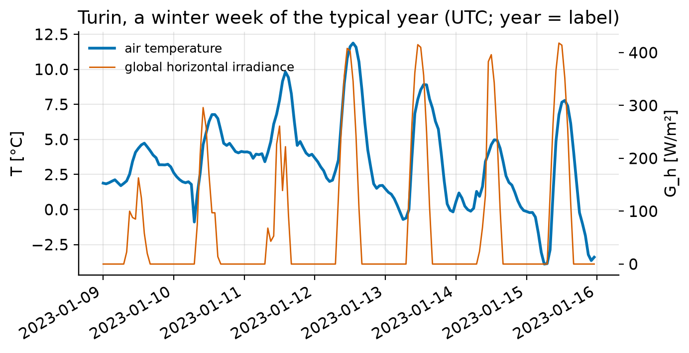
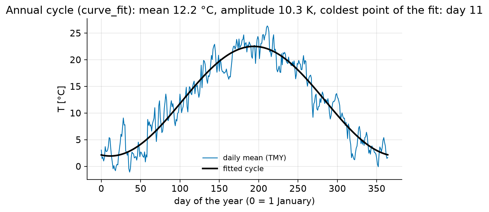

# What Session 0 is

- A **2.5-h session**, extra to the 20 core hours
- We follow the **notebook** on the Turin weather together; the **guide** is the reference
- At the end: the self-check exercise **S0.1**
- After the session, the guide is there to review at your own pace

# Objectives

- Install the course environment and run the tests
- Know when to use a **notebook** and when a **script**
- Read and write the **Python subset** the course uses
- Use **NumPy**, **pandas**, **Matplotlib**, **SciPy** on a real time series
- Compute in **SI**, display in °C and kWh
- Find your way in the course package `energy_training`

# Why Python in this course

- Physical models are written in **Modelica** (Sessions 3–5)
- **Python** around them:
  - prototype a model before Modelica (Sessions 1–2)
  - read and plot weather and results
  - run many simulations of an exported model, an FMU (Session 6)
  - costs (Session 7) and optimization (Session 8)
- You need to **read, run and modify** short code, not to be a programmer

# The case study

- One **house in Turin**: heat pump, thermal storage tank, PV, battery, grid connection
- Each session adds one piece; Sessions 7–8 ask which sizes and which operation cost least
- Session 0 already uses its **weather**: a typical meteorological year from PVGIS

# Roadmap

- **S0 — Python 101** ← today
- S1–S2 — dynamic models in Python (zone, storage)
- S3–S5 — the same models and the system in Modelica
- S6 — the model as an FMU, scenarios from Python
- S7–S8 — costs, optimal design and operation

# Install the environment

- Follow the software setup up to "open the notebooks" (30–45 min, mostly downloads)
- **uv** installs Python and the packages and runs commands in the course environment
- In a terminal, inside the course folder:
  - `uv sync` — make the environment match the lock file
  - `uv run pytest` — must end with `NN passed`
- OpenModelica can wait until Session 3

# What uv uses

- `pyproject.toml` — the project and the packages it needs
- `.python-version` — the Python version (3.12)
- `uv.lock` — the **exact** version of every package; never edited by hand
- `.venv/` — the environment itself, a folder in the course directory
- `uv run <command>` — runs inside the environment; no activation needed

# Why a lock file?

- Numerical results change, slightly, between library versions
- Same `uv.lock` → **your numbers and plots match the course material**
- So: run `uv sync` after updating the course files
- Do **not** run `uv add` or upgrade packages in the course folder

# Notebooks and scripts

- **Notebook** (`.ipynb`): text, code and results together — to explore and explain
  - opened in **JupyterLab**, the course interface: `uv run jupyter lab`
- **Script** (`.py`): runs top to bottom — for exercises, figures, tests
  - `uv run python exercises/session_00/s00_self_check.py`
  - edit it in JupyterLab, run it from a JupyterLab terminal

# Working in JupyterLab

- Start from the course folder: `uv run jupyter lab`; keep the terminal open
- Kernel top right: **Python 3 (ipykernel)** = the course `.venv`
- File browser (left) → `python/notebooks/`; launcher → new terminal
- **Shift+Enter** run cell · **Esc** / **Enter** command / edit mode · **A** / **B** new cell
- **Kernel → Restart Kernel and Run All Cells…** before trusting a result
- Stop: **File → Shut Down** (closing the tab is not enough)

# Notebook rules

- Variables live in the **kernel**; running cells out of order gives results nobody can reproduce
- Before trusting a result: **Restart** the kernel and **Run All**
- Reusable code lives in the **course package**; notebooks import it
- A cell hangs → *Interrupt*; strange variables → *Restart*

# The Python subset

- Numbers, names, f-strings: `f"{Q_flow:.0f} W"`
- Lists, dicts, `for` loops, comprehensions
- Functions with docstrings and keyword arguments
- **Frozen dataclasses** for parameters: `ThermalZoneParams(C=1e7, UA=200.0)`
- Imports from the course package
- `try` / `except` to report an error
- Not needed: other classes, decorators other than `@dataclass`, async code, writing packages

# NumPy: arrays

- One type of number per array; operations apply to **all elements at once**
- A function written for numbers often works on arrays too (notebook: `heat_loss`)
- **Masks** select by a condition: `T[T < 273.15]`
- Pitfalls: `b = a` does not copy (use `a.copy()`); compare floats with `np.isclose`

# pandas: time series

- `Series` = one labelled column, `DataFrame` = a table sharing one index
- Time index: `.loc["2023-01-09":"2023-01-15"]` selects a week
- `resample("D")`, `resample("MS")`: daily and monthly values
- `groupby`: rows with the same key (month, hour of the day)
- `tz_convert("Europe/Rome")`: changes the labels, not the data

# The weather file: look before you use it

- A **typical meteorological year**: 12 months taken from different years
- Raw time stamps **jump between years** at month boundaries
- `energy_training.data.weather.load_tmy()`: one continuous hourly year, SI units, UTC
- Rows are labelled HH:00; irradiance belongs to HH:00 + 0.176 h (matters for the sun position, Session 5)

# A winter week in Turin

# Matplotlib: the course pattern

- `fig, ax = plt.subplots()`, then methods on `ax`
- **Every axis labelled with its unit**: `ax.set(ylabel="T [°C]")`
- `apply_style()` for the course style
- `degc()` and `hours()` convert **for display only**
- A second y axis: `ax.twinx()`

# Units

- Python has no units: **compute in SI** (K, W, J, J/K, kg/s, Pa)
- Convert to °C, kWh, hours **only for display**
- Names and comments carry the unit: `UA = 185.0  # W/K`
- Names follow the course notation: `T_amb`, `Q_flow`

# SciPy: a first fit

$$T(d) = \bar T - A\cos\!\left(\frac{2\pi\,(d - d_0)}{365}\right)$$

- `scipy.optimize.curve_fit` finds $\bar T$, $A$, $d_0$ from the daily means
- Later: ODE solvers (Sessions 1–2), optimization (Session 8)

# The annual cycle

# A first look at the case study

$$\dot Q = UA\,(T_{set} - T_{amb}) \quad \text{when } T_{amb} < T_{set}$$

- $UA$ = 185 W/K (a measured house, as an example), $T_{set}$ = 20 °C
- About **13,900 kWh** of heat per year; peak **4.8 kW**
- Energy per year → running cost; peak → heat-pump size
- Simplification: no heat capacity, no solar or internal gains

# The course package `energy_training`

- All reusable code, in `python/src/energy_training/`; installed by `uv sync`
- `utilities` — units, paths · `plotting` — style, °C and h for display
- `data` — weather now, demand profiles later · `simulation` — the Python models (from Session 1)
- `help(function)` shows the docstring
- **Tests**: `uv run pytest` — if they pass, the environment is fine

# Tools you will meet later

- **OpenModelica** (OMEdit, `omc`): Modelica models, FMU export — Sessions 3–5
- **FMPy**: simulate FMUs from Python — Sessions 6–8
- `scipy.optimize.linprog`, `milp`: operation and sizing — Session 8
- **CasADi** (optional extra), Pyomo, linopy: mentioned for larger problems
- Nothing to install now

# Self-check: exercise S0.1

1. The notebook `s00_python_101.ipynb` runs with **Restart + Run All**
2. Exercise **S0.1**: daily and monthly statistics of the Turin weather, a plot
3. `uv run pytest` ends with **passed**

- Not finished in class? Complete it at home; note any error and the step, bring it to Session 1

# Common problems

- `uv` not recognised → reopen the terminal
- No `energy_training` in a notebook → restart JupyterLab with `uv run jupyter lab` in the course folder
- The same error in a script → `uv run python`
- `FileNotFoundError` → run from the course folder
- Numbers slightly different → `uv sync`, no upgrades
- Fails after Restart + Run All → fix the cell order

# Key takeaways

- `uv sync` once, then **`uv run`** for everything
- Notebooks to explore, scripts to reproduce; **Restart + Run All**
- **Look at the data** before using it (time stamps, units, time zone)
- **SI inside**, °C and kWh only on the plot
- Next: Session 1 — the first dynamic model of the house
