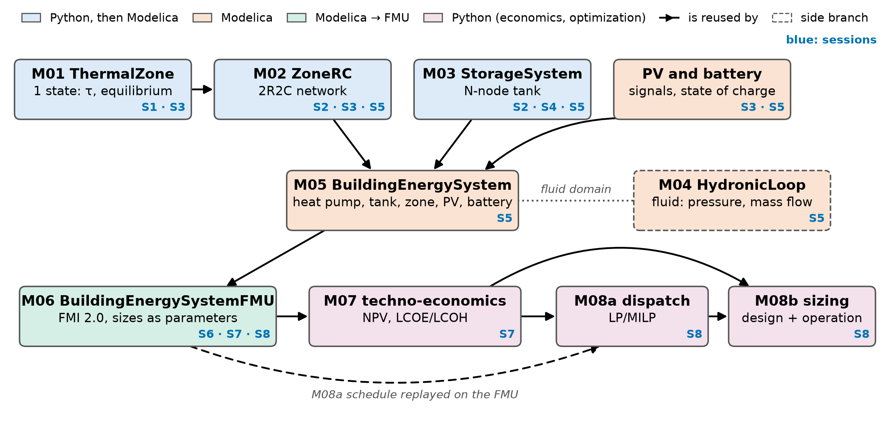
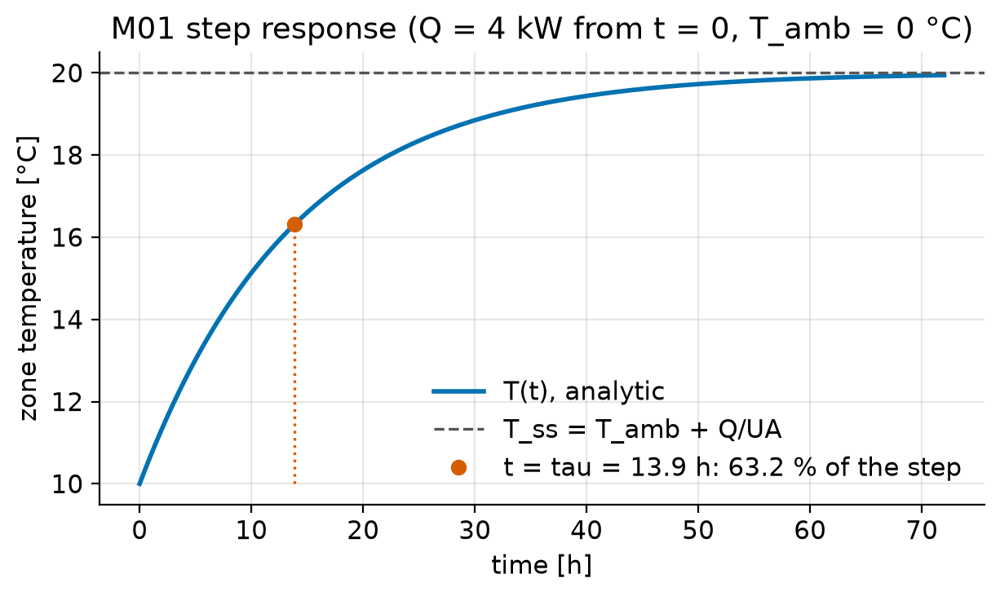
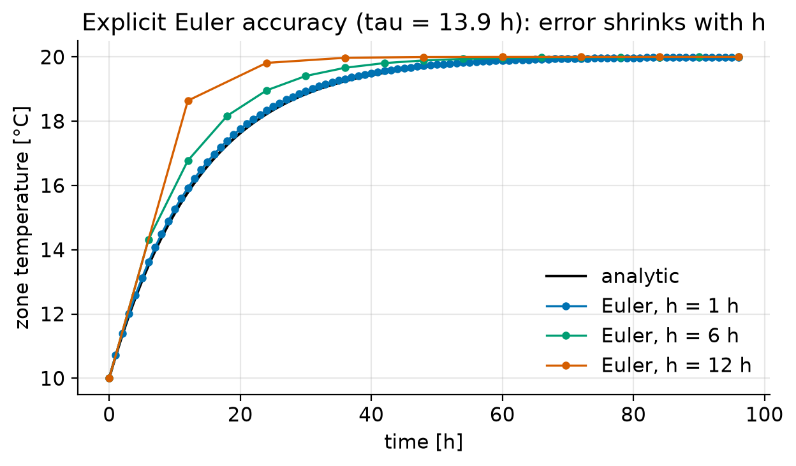
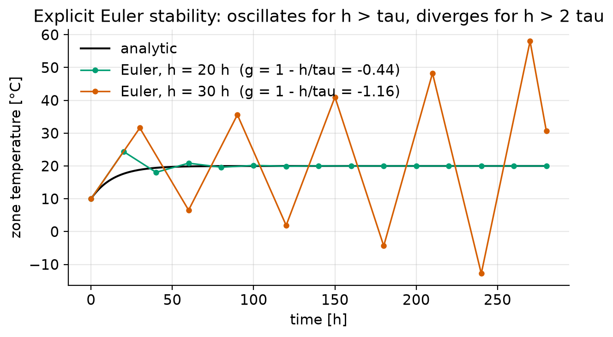
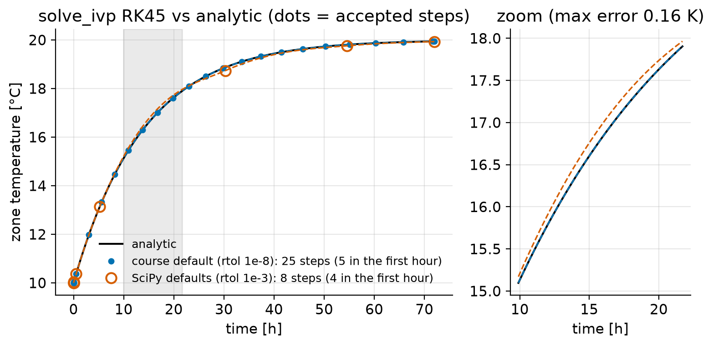
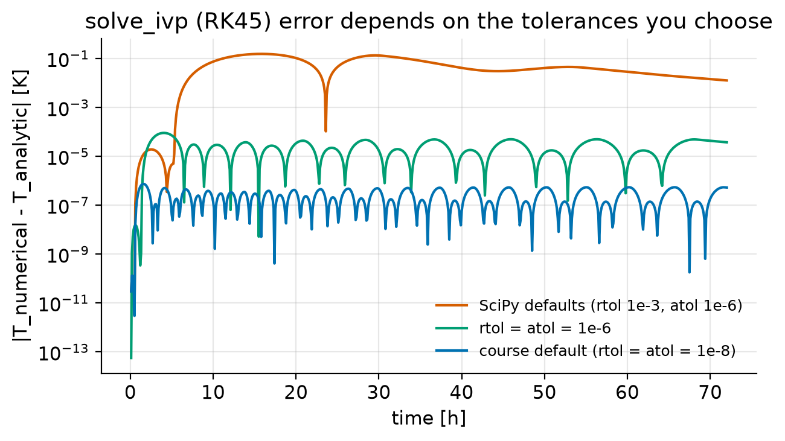
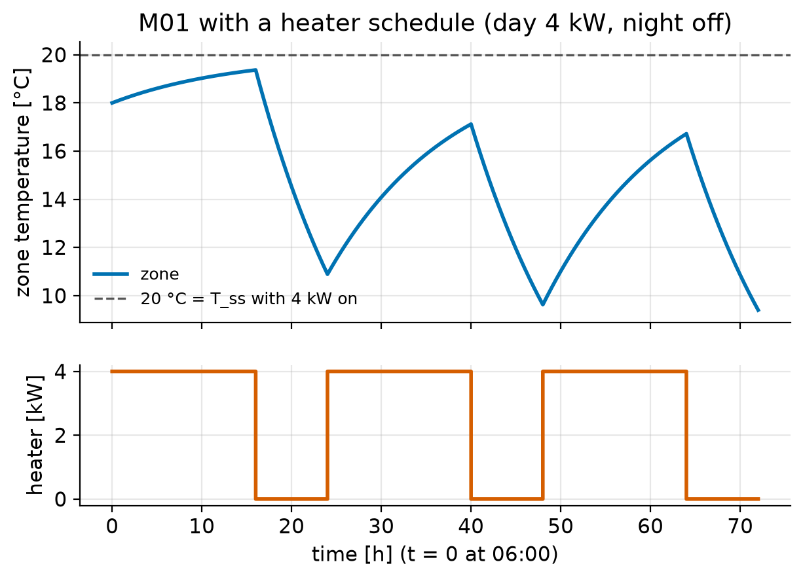

# Objectives

- Distinguish **static** and **dynamic** models
- Identify **states, inputs, outputs, parameters**
- Derive the energy balance of a **lumped thermal mass**
- Compute **equilibrium** and **time constant**; solve the step response
- Integrate numerically and judge **accuracy and stability**
- Write the model in **state-space** form; first look at a **DAE**

# The course workflow

Physical system → assumptions → conservation laws → mathematical model → ODE / DAE →
Modelica → simulation → FMU → Python → costs and optimization

Today: the first five steps, in **Python**

# Roadmap: one building, built piece by piece

- **S1 — M01 thermal zone (1 state)** ← today
- S2 — M02 zone RC (2 states), M03 storage tank
- S3–S4 — the same models in Modelica
- S5 — heat pump, storage, PV, battery: the full system (M05)
- S6 — FMU and Python: scenarios (M06)
- S7–S8 — costs, then optimal sizes and operation

# The model family M01–M08



# The case study: one house

- Single-family house in Turin
- Needs: **space heating**, **hot water**, **electricity**
- Assets: **heat pump**, **thermal storage**, **PV**, **battery**, grid
- Final question: which **sizes** and which **operation** cost least?
- Today: the house as **one thermal mass**

# Static vs dynamic

- **Static:** output now depends on input now
  - $\dot Q_{loss} = UA\,(T - T_{amb})$
- **Dynamic:** something is **stored** → memory
  - thermal energy in the zone: $\Delta E = C\,\Delta T$
- Need a dynamic model when storage time scale ≈ question time scale
  - night set-back, heat-pump cycling, storage

# States, inputs, outputs, parameters

- **State** — under $d/dt$, needs an initial value → $T$
- **Input, manipulated** — we choose it → $\dot Q$
- **Input, disturbance** — the environment imposes it → $T_{amb}$
- **Output** — we observe or report it → $T$
- **Parameter** — constant during a run → $C$, $UA$

# Lumped modelling

- Zone = **one node** at uniform temperature $T$
- Solid bodies: lumping OK if Biot number $Bi = h_c L_c/k \lesssim 0.1$
- A building zone is not a homogeneous solid → lumping is an **assumption**
  justified by the question (hour-scale behaviour)
- Session 2 relaxes it (two nodes)

# M01: system and assumptions

- Boundary: zone envelope; energy in = heater $\dot Q$, energy out = losses
- A1 uniform $T$ · A2 constant $C$ · A3 losses $UA\,(T - T_{amb})$
- A4 ideal heater · A5 $\dot Q(t)$, $T_{amb}(t)$ given

# Energy balance → ODE

$$C\,\frac{dT}{dt} = \dot Q(t) - UA\,\bigl(T - T_{amb}(t)\bigr), \qquad T(0) = T_0$$

- stored = in − out
- Illustrative values: $C = 10^7$ J/K, $UA = 200$ W/K, $T_{amb} = 0$ °C, $\dot Q = 4$ kW

# Equilibrium and time constant

- Equilibrium ($dT/dt = 0$): $T_{ss} = T_{amb} + \dot Q/UA$ = **20 °C**
- Rewrite: $\tau\,\dot T = -(T - T_{ss})$ with $\tau = C/UA$ = **13.9 h**
- $C$ changes *how fast*, never *where to* ($T_{ss} - T_{amb} = \dot Q/UA$)
- Step response (constant inputs):

$$T(t) = T_{ss} + (T_0 - T_{ss})\,e^{-t/\tau}$$

- 63.2 % of the change after $\tau$, 95 % after $3\tau$

# Step response



# Explicit Euler by hand

$$T_{k+1} = T_k + h\,f(t_k, T_k)$$

```python
for k in range(len(t) - 1):
    T[k + 1] = T[k] + h * rhs(t[k], T[k])
```

- One function evaluation per step; global error $\propto h$

# Euler: accuracy



# Euler: stability

Deviation from equilibrium $x = T - T_{ss}$:

$$x_{k+1} = \left(1 - \frac{h}{\tau}\right)x_k = g\,x_k$$

- $h < \tau$: $0 < g < 1$ → monotone, like the exact solution
- $\tau < h < 2\tau$: $-1 < g < 0$ → **oscillates**
- $h > 2\tau$: $g < -1$ → **diverges**

# Euler: stability (simulation)



# solve_ivp: adaptive steps

- SciPy `solve_ivp`: default method RK45 (explicit Runge–Kutta, order 5(4))
- Step size chosen automatically from local error estimates
- Defaults: `rtol=1e-3`, `atol=1e-6` — **a modelling choice, not a law**
- Course wrapper `thermal_zone.simulate` uses `rtol = atol = 1e-8`

# solve_ivp: tolerances matter



# solve_ivp: the error, quantified



# State-space form

$x = T$, $\quad u = [\dot Q,\ T_{amb}]^\top$, $\quad y = T$

$$\dot x = A\,x + B\,u, \qquad y = C_y\,x + D\,u$$

$$A = -\frac{UA}{C}, \quad B = \begin{bmatrix}\frac{1}{C} & \frac{UA}{C}\end{bmatrix}, \quad C_y = 1, \quad D = \begin{bmatrix}0 & 0\end{bmatrix}$$

- Eigenvalue of $A$ = $-1/\tau$
- **Linear** → superposition: response to $\dot Q$ + response to $T_{amb}$
- Preview M02: air + building mass → 2 states, two time constants
- Reused in Session 8 (optimal operation)

# Time-varying inputs

- Heater schedule = **piecewise-constant** input
- Restart integration at each jump (`piecewise_constant` → breakpoints)
- Check with the energy balance: $C\,\Delta T = \int\dot Q\,dt - \int UA\,(T - T_{amb})\,dt$

# Heater schedule result



# Preview: the same physics as a DAE

$$C\,\dot T = \dot Q - \dot Q_{loss}, \qquad 0 = \dot Q_{loss} - UA\,(T - T_{amb})$$

- Unknowns $T$, $\dot Q_{loss}$; one differential + one algebraic equation
- This is how Modelica receives a model built from components (Session 3)

# Exercises

- **G1.1** (guided, 15 min): step response — read τ and $T_{ss}$, compare with $C/UA$
- **I1.1** (independent, 15 min): heater schedule — energy use and comfort

Files: `exercises/session_01/`

# Key takeaways

- A **state** carries memory; here the stored energy ($\Delta E = C\,\Delta T$)
- **τ = C/UA** sets the speed; **$\dot Q/UA$** sets the equilibrium
- Numerical results depend on **step size and tolerances**
- Inputs with **jumps** need explicit handling
- Same model next: **Modelica** (Session 3) after more physics (Session 2)
