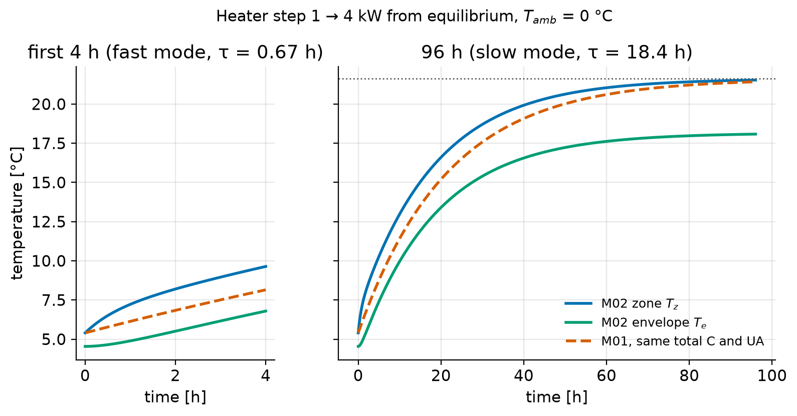
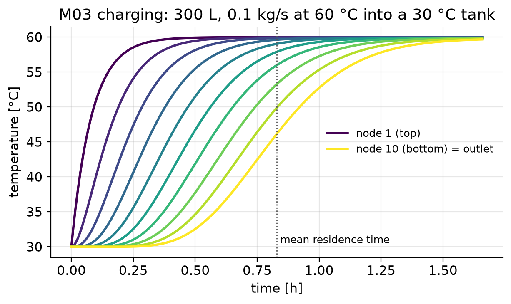
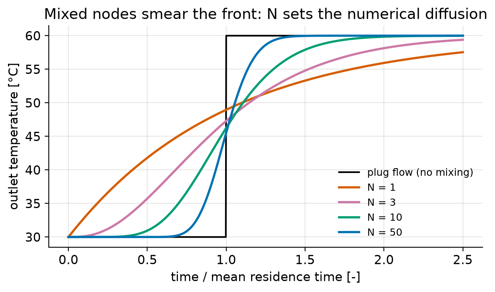
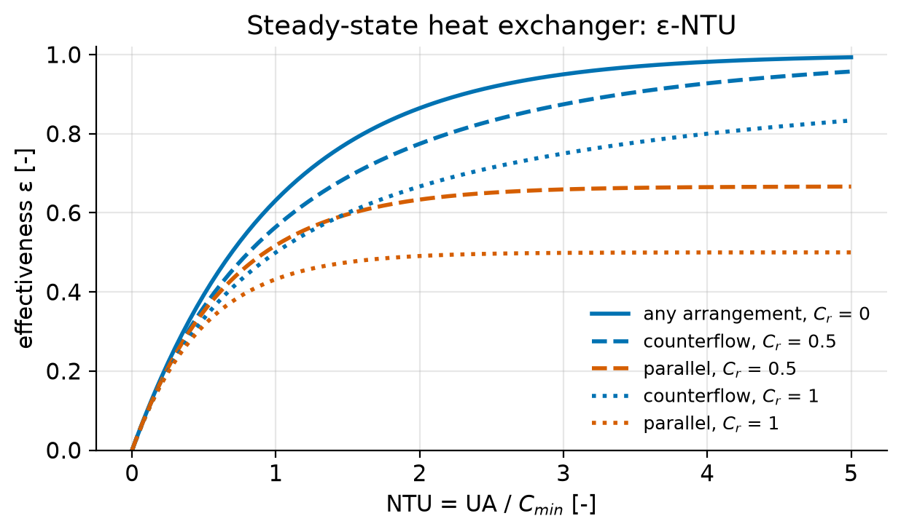

# Objectives

- **Mass and energy balances** of a control volume with flows
- Heat transfer as **resistances**; **RC networks**
- **M02** (2 nodes): simulate, read the **time constants**
- **M03** (tank, N nodes): simulate, check the **energy balance**
- **Steady-state** heat exchanger (ε-NTU): when is it acceptable?
- How the **number of nodes** changes the dynamics

# Recap: M01 and its limits

- One node: $C\,\dot T = \dot Q - UA\,(T - T_{amb})$
- One time constant $\tau = C/UA$, one equilibrium $T_{amb} + \dot Q/UA$
- Real buildings: air reacts in **minutes to hours**, walls over **a day**
- No mass flows: cannot describe a **water tank** or a **heating loop**

# Roadmap

- S1 — M01 thermal zone (1 state)
- **S2 — M02 zone RC (2 states), M03 storage tank (N states)** ← today
- S3–S4 — the same models in Modelica
- S5 — heat pump + storage + zone + PV + battery (M05)
- S6–S8 — FMU and scenarios, costs, optimal design and operation

# Control volume: conservation laws

- Choose a **boundary**; count what crosses it
- **Mass:** in − out = accumulation
- **Energy:** enthalpy in − enthalpy out + heat in − work out = accumulation
- Liquid water, constant $c_p$, no phase change:

$$\dot m\,c_p\,(T_{in} - T_{out})$$

# When is $\dot m\,c_p\,\Delta T$ valid?

- **Incompressible** fluid: enthalpy depends on temperature only
- **Constant** $c_p$ over the temperature range
- **No mass storage**: in-flow = out-flow
- **No phase change** (not the refrigerant side of a heat pump)
- Course water: $\rho$ = 995.586 kg/m³, $c_p$ = 4184 J/(kg·K)

# Heat transfer as resistances

- Conduction through a layer: $R = L/(kA)$
- Convection at a surface: $R = 1/(h_c A)$
- Radiation, linearised: $h_r \approx 4\varepsilon\sigma T_m^3$ ≈ 5 W/(m²·K) at room temperature
- Series: resistances add · parallel: conductances add
- Heat capacity = **capacitor to ground** · $\tau = RC$

# M02: two-node building model

$$C_z\frac{dT_z}{dt} = \frac{T_e - T_z}{R_{ze}} + \dot Q$$

$$C_e\frac{dT_e}{dt} = \frac{T_z - T_e}{R_{ze}} + \frac{T_{amb} - T_e}{R_{ea}}$$

- Zone (air + light mass) and envelope (heavy construction)
- Deterministic part of the Bacher & Madsen (2011) two-state model

# M02 parameters: one measured house

- 120 m² single-storey house, estimated from measurements
- $C_z$ = 1.07 kWh/K, $C_e$ = 2.92 kWh/K
- $R_{ze}$ = 0.863 K/kW, $R_{ea}$ = 4.54 K/kW
- Total: $C$ ≈ 1.44·10⁷ J/K, $UA$ ≈ 185 W/K
- An **example**, not a typical value

# M02 in state-space form

$x = [T_z,\ T_e]^\top$, $\quad u = [\dot Q,\ T_{amb}]^\top$, $\quad y = T_z$

$$A = \begin{bmatrix} -\frac{1}{R_{ze}C_z} & \frac{1}{R_{ze}C_z}\\ \frac{1}{R_{ze}C_e} & -\frac{1}{C_e}\left(\frac{1}{R_{ze}}+\frac{1}{R_{ea}}\right)\end{bmatrix}, \quad B = \begin{bmatrix}\frac{1}{C_z} & 0\\ 0 & \frac{1}{R_{ea}C_e}\end{bmatrix}$$

- Equilibrium: $T_z = T_{amb} + \dot Q\,(R_{ze} + R_{ea})$
- Time constants: $\tau_i = -1/\lambda_i$ of $A$

# M02: a heater step

# M03: a storage tank as N mixed nodes

- Tank volume $V$, $N$ layers of equal mass, **node 1 at the top**
- Charging: hot water in at the top, out at the bottom
- Each node is a **control volume**: advection, conduction, losses

$$m_k c_p \frac{dT_k}{dt} = \dot m\,c_p\,(T_{k-1} - T_k) - \frac{UA_{loss}}{N}(T_k - T_{env})$$

- $T_0 \equiv T_{in}$; conduction $G\,(T_{k-1} - 2T_k + T_{k+1})$ optional

# M03: global energy balance

$$\frac{d}{dt}\sum_k m_k c_p T_k = \dot m\,c_p\,(T_{in} - T_{out}) - \sum_k \frac{UA_{loss}}{N}(T_k - T_{env})$$

- Advection terms **telescope**: only inlet and outlet remain
- Conduction terms **cancel** in pairs
- Numerical check: stored − (advected − lost) ≈ 0

# M03: charging the tank

# How many nodes?

# More nodes, faster nodes: stiffness

- Node time constant $\rho V/(N\dot m)$: 5 min for $N$ = 10
- Standby losses: $\rho V c_p/UA_{loss}$ ≈ 174 h
- One day of charging, right-hand-side calls:
  - $N$ = 10: RK45 776, BDF 207
  - $N$ = 200: RK45 21842, BDF 615
- Session 4: why implicit solvers win here

# Steady-state components: heat exchanger

$$\dot Q = \varepsilon\,C_{min}\,(T_{h,in} - T_{c,in}), \qquad NTU = \frac{UA}{C_{min}}, \qquad C_r = \frac{C_{min}}{C_{max}}$$

$$\varepsilon_{counter} = \frac{1 - e^{-NTU(1-C_r)}}{1 - C_r\,e^{-NTU(1-C_r)}}$$

$$\varepsilon_{parallel} = \frac{1 - e^{-NTU(1+C_r)}}{1 + C_r}$$

- No state: answers **instantly**

# ε-NTU: counterflow wins

# Model fidelity: what to keep?

- Keep a **state** when its time scale matters for the question
- Use a **steady-state** relation when the component is much faster
- More nodes: sharper fronts, **stiffer** equations
- Check: does the answer change when the model is refined?

# Exercises

- **G2.1** (guided, 15 min): node equations of M03, energy balance residual, effect of $N$
- **I2.1** (independent, 10 min): eigenvalues of M02, modes, step response
- Files: `exercises/session_02/`

# Key takeaways

- Each node is a **control volume**: write its balance, then connect nodes
- Connections are **conductances** or **mass flows**
- More states → more **time scales**: read them from the **eigenvalues**
- $N$ is a modelling decision with a **numerical price**
- Next: write only the equations and let a tool do the rest — **Modelica** (Session 3)
