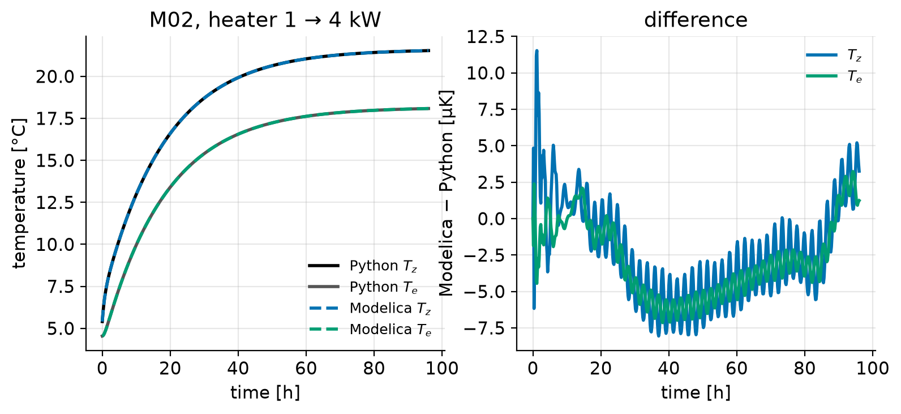
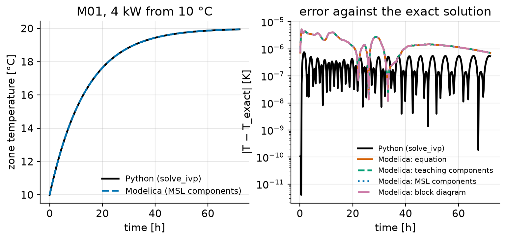

# Objectives

- **Equations** instead of assignments: what the compiler must do
- **M01 in Modelica**: parameters, **units and types**, initial equation — same numbers as Python
- **Connectors**: across and through variables; what `connect` generates; **counting** equations
- **Library components** (MSL): read them, then use them
- **Modifications**, `final`, `extends`, `replaceable`, `redeclare`: **M01 → M02**
- **Three formulations**: equation, components, block diagram

# Roadmap

- S1–S2 — M01, M02, M03 in Python
- **S3 — the same models in Modelica** ← today
- S4 — how OpenModelica compiles and solves; debugging
- S5 — heat pump + storage + zone + PV + battery (M05, Buildings library)
- S6–S8 — FMU and scenarios, costs, optimal design and operation

# Reading map

- Main reference: *Modelica by Example* (M. Tiller), free at mbe.modelica.university
- Before today: *Simple First Order System*, *Getting Physical*, *Equations*, *Connectors*
- Each part of today's lesson points to its section (lesson §3)
- Second tutorial: P. Fritzson, OpenModelica tutorial, Modelica Conference 2025
- Book code uses `Modelica.SIunits` → in MSL 4.1.0: `Modelica.Units.SI`

# Python: assignments

$$\dot T = \frac{1}{C}\bigl(\dot Q - UA\,(T - T_{amb})\bigr)$$

- You decide **what is computed from what**
- You write the **right-hand side** and call the solver
- A new node = a new `rhs` and a new state vector

# Modelica: equations

$$C\,\frac{dT}{dt} = \dot Q - UA\,(T - T_{amb})$$

- An equation states that two expressions are **equal**; no order between equations
- $R\,i = v$ can give $i$, $v$ or $R$: decided when the resistor is **used**
- The compiler **flattens**, **sorts** and **solves** (Session 4)
- So a component works whatever it is connected to

# Block diagram or schematic?

- **Block diagram**: outputs feed inputs; the diagram is the **solved** form
- **Schematic**: components share **ports**; heat may flow either way
- Modelica has both: `block` (inputs and outputs only) and physical `model`s with connectors
- The physical style is called **acausal**

# M01 as one Modelica model

```modelica
parameter SI.HeatCapacity C = 1.0e7;
parameter SI.ThermalConductance UA = 200;
SI.Temperature T;
initial equation
  T = T0;
equation
  C*der(T) = Q_flow - UA*(T - T_amb);
```

- `SI` = `Modelica.Units.SI` · file: `Examples/S03_ThermalZoneEquations.mo`

# Variables and attributes

- `constant`: fixed at translation · `parameter`: fixed during a run · variable: changes
- `unit`, `displayUnit`: K in the equations, °C on the plot
- `start` + `fixed = true` ≡ `initial equation`; `start` alone is only a guess
- `min`, `max`: bounds · `nominal`: typical size, used by the solver
- Steady start: `initial equation der(T) = 0;`

# Units and types

- `SI.Temperature`: unit K, display °C, min 0, nominal 300 K
- `SI.TemperatureDifference`: unit K, **relative** (no 273.15 offset in °C)
- One type declaration gives all the attributes
- Both sides of every equation must have the **same unit**

# The tool finds a unit error

```modelica
C*der(T) = Q_flow - UA*T - T_amb;
```

- Missing parentheses. `checkModel` (OMEdit: *Check Model*): equation **inconsistent** — `Q_flow - UA*T` is W, `T_amb` is K
- `simulate` runs it **without** a warning
- Plain `Real` without unit: **not** checked
- So: check the model, then simulate

# Connectors: across and through

- **Across** (potential): its difference drives the exchange — $T$, $v$, angle
- **Through** (flow): rate of a **conserved** quantity — $\dot Q$, $i$, torque
- Sign: through variable > 0 **into** the component

```modelica
connector HeatPort
  SI.Temperature T;
  flow SI.HeatFlowRate Q_flow;
end HeatPort;
```

# What `connect` generates

- All `connect`s on one port form a **connection set**
- **Potential** variables: equal, $T_a = T_b = T_c$
- **Flow** variables: sum to zero, $\dot Q_a + \dot Q_b + \dot Q_c = 0$
- Zero sum = **energy balance** of a point that stores nothing
- Unconnected flow variable = **zero** (an insulated port)

# Teaching components and the count

- `ThermalMass`: $T = T_{port}$, $\;C\,\dot T = \dot Q_{port}$ — 1 pair + 1 local = **2**
- `ThermalConductance`: $\dot Q = G\,(T_a - T_b)$, $\dot Q_a = \dot Q$, $\dot Q_b = -\dot Q$ — 2 + 1 = **3**
- `FixedTemperature`: $T_{port} = T_{fixed}$ — **1**
- `HeatSource`: $\dot Q_{port} = -\dot Q_{in}$ — **1**. Why the minus sign?
- Rule: one equation per port pair, plus one per local variable, plus one per output

# M01 from components: the flat model

- Zone node — generated: `zone.port.T = loss.port_a.T`, `zone.port.T = heater.port.T`
- Generated: `heater.port.Q_flow + loss.port_a.Q_flow + zone.port.Q_flow = 0`
- 14 unknowns = 8 component + 6 connection equations: **balanced**
- Trivial equations removed → $C\,\dot T = \dot Q - G\,(T - T_{amb})$

# The Modelica Standard Library

- `Modelica.Thermal.HeatTransfer`: `HeatCapacitor`, `ThermalConductor`, `FixedTemperature`, `PrescribedTemperature`, `PrescribedHeatFlow`
- Same equations as the teaching components — **read the source**
- `HeatCapacitor` = `ThermalMass` + `der_T`; its `T` starts at 293.15 K unless you say otherwise
- M01 in the course library: `EnergyTraining.Systems.ThermalZone`

# Packages, files and names

- A package is a folder: `EnergyTraining/Components/ThermalMass.mo`
- First line: `within EnergyTraining.Components;` · `package.order`: browser order
- Full name: `Modelica.Units.SI.Temperature`
- `import SI = Modelica.Units.SI;` → `SI.Temperature`
- Avoid `import ….*`: you lose track of where names come from

# Classes

- `model`: the general modelling class
- `block`: inputs and outputs only (signals)
- `connector`: variables at a port, no equations
- `record`: data · `type`: a `Real` with attributes (`Temperature`)
- `package`: a library of classes and constants

# Modifications and `final`

```modelica
HeatCapacitor zone(C = C, T(start = T_start, fixed = true));
HeatCapacitor layer[5](each C = 2e5);
```

- A modification sets a value where a component is declared or inherited
- `each`: the same value for every element of an array
- `final`: nobody can change it later → one value, one place
- `ThermalZone`: `zone(final C = C)` — the parameter is **propagated**

# `partial` and `extends`

- `partial model PartialHeatPath`: two heat ports, **no equations**
- Cannot be simulated: it is an **interface**, incomplete on purpose
- `model EnvelopeUA extends PartialHeatPath` + one `ThermalConductor`: an **implementation**
- `extends` inherits elements and equations; modifications change parameters

# `replaceable` and `redeclare`

```modelica
replaceable EnvelopeUA envelope(UA=UA)
  constrainedby PartialHeatPath;
```

- `replaceable`: the type of `envelope` may change later
- `constrainedby`: every replacement must fit this **plug**
- `redeclare`: put another component in its place
- With `constrainedby`, modifications on the declaration are **not** kept: repeat them in the `redeclare`

# M02 = M01 with another envelope

```modelica
model ZoneRC
  extends ThermalZone(
    C=C_z,
    redeclare EnvelopeRC envelope(
      C_e=C_e, R_ze=R_ze, R_ea=R_ea));
```

- `EnvelopeRC`: conductance – capacity – conductance
- One state more, **no connection changed** (shortened; full code in `Systems/ZoneRC.mo`)

# M02: Modelica = Python



# Three formulations of M01

- **Equation**: one balance; the compiler chooses the causality; units checked
- **Components**: physical structure; units checked; M02 = one `redeclare`
- **Block diagram** (`S03_ThermalZoneBlocks`): integrator, gain, feedback — the **solved** form; signals have **no units**; M02 = redraw the loop
- Same numbers for all three
- Physics in components, control in blocks

# M01: Modelica = Python



# Simplified PV and battery (I3.1)

- Blocks with `RealInput`/`RealOutput`: signals with a direction
- PV: $P = A\,f_{act}\,\eta\,G_h$ (horizontal panel; code name `G`)
- Battery: $E_{max}\,\dot{SOC} = P_{act}$; charging $P_{act} = \eta_{cha}P$, discharging $P/\eta_{dis}$
- Same equations as the Buildings components of Session 5
- **No limits** on $SOC$: why not?

# Common errors

- Heater sign: `port.Q_flow = Q_flow` cools the zone
- Unconnected ports: the model runs, the result is wrong
- Unit warning at *Check Model*: a typo, not a detail
- `start` without `fixed = true`: only a guess (warning)
- `final` overridden, `each` missing, modification lost by `redeclare`
- `Modelica.SIunits` in book examples → `Modelica.Units.SI`

# Exercises

- **G3.1** (guided, 20 min): M02 from MSL components; compare with Python (< 0.01 K)
- **I3.1** (independent, 10 min): `SimplePV` and `SimpleBattery` blocks; one April day in Turin
- Files: `exercises/session_03/`

# Key takeaways

- Modelica models are **equations**; **types** carry units: check, then simulate
- `connect`: equal **potentials**, **flows** summing to zero; every component balanced
- Read the **library** source, then reuse it; set values once (`final`)
- `replaceable` + `redeclare`: change the structure, keep the connections
- Next: what the compiler does, and what to do when it fails — **Session 4**
