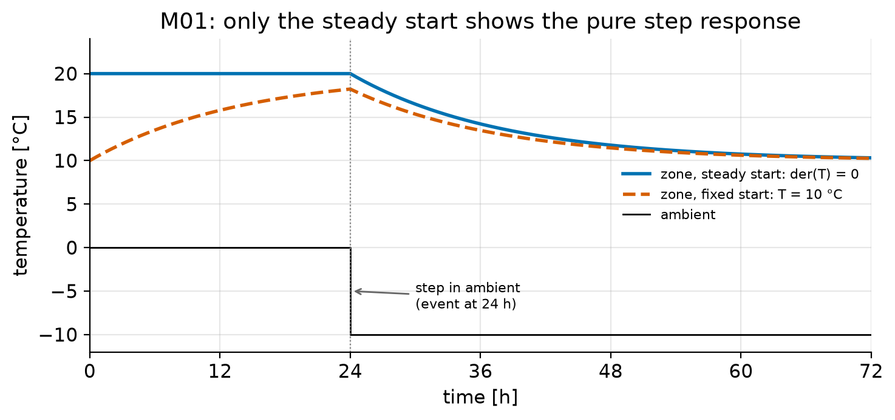
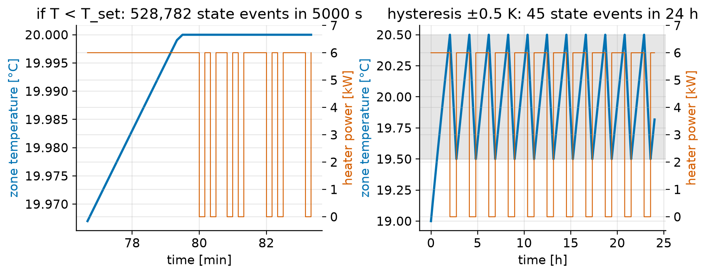
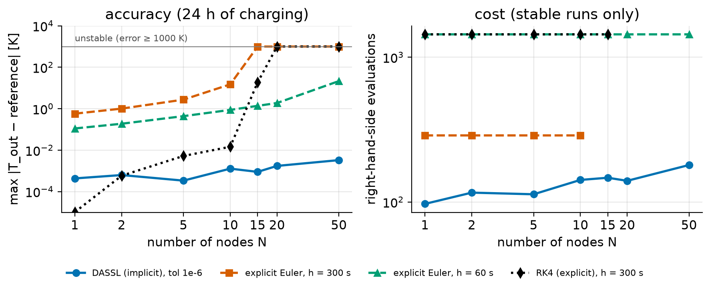

# Objectives

- What happens between the **equations** and the **numbers**
- **Simulation setup** and the **log**: what to read, where
- **Initialization**: how many conditions, how to give them, steady start
- **Events**: time and state events; why a thermostat can stall a simulation
- **Stiffness**: implicit vs explicit solvers; solver error vs model error
- A **checklist** for failed or wrong simulations

# Roadmap

- S1–S2 — M01, M02, M03 in Python
- S3 — M01, M02 in Modelica
- **S4 — M03 in Modelica; how OpenModelica solves; debugging** ← today
- S5 — heat pump + storage + zone + PV + battery (M05)
- S6–S8 — FMU and scenarios, costs, optimal design and operation

# Reading map

- *Modelica by Example*: **Initialization**, **Cooling Revisited**, **State Event Handling**, **Hysteresis**
- Each part of today's lesson points to its section (lesson §3)
- Fritzson tutorial (2025): pipeline, debugger, events
- Solvers, stiffness, OMEdit: OpenModelica **User's Guide**
- The book has no solver chapter: that part is ours

# From model to simulation

1. **Translate**: flat model → structure analysis → C code
2. **Compile** the C code into an executable
3. **Run** the executable → result file

- Re-simulating with new parameter values repeats only step 3
- Changing an **array size** (tank nodes $N$) needs step 1 again

# What the back end does

- **Match**: each equation gets the unknown it computes
- **Sort**: an order in which every equation uses known values only (**BLT** form)
- States are known (from the integrator); their **derivatives** are unknowns
- Result for M01, after removing the trivial equations:
  - $\dot Q_{loss} = UA\,(T - T_{amb})$
  - $\dot T = (\dot Q - \dot Q_{loss})/C$

# Algebraic loops and tearing

- A wall of **two layers without capacity**: the temperature between them is no state
- Unknowns of the loop: interface $T$, two layer flows, … solved **together**
- **Tearing**: guess the interface $T$, compute the rest one by one, correct the guess
- Linear loop: solved directly
- Nonlinear (radiation, $T^4$): **Newton**, from the **start value**

# States and index

- Two heat capacities connected **without resistance**: one temperature
- Two `der(T)` in the equations, but only **one state**
- The compiler may differentiate equations to get an ODE: **index reduction**
- Fix **both** start values → error: *conflicting fixed start values*

# Simulation setup

- **Start, stop**, **interval** (fixed-step methods: also the step)
- **Method** `dassl` (default), `ida`, `cvode`, `euler`, …; **tolerance** 1e-6
- Defaults: the model's `experiment` annotation
- Adaptive solvers **interpolate** the output points
  - M03, 3 h: interval 600, 60 or 10 s → **109 steps**, same error
- Accuracy: change the **tolerance** (or the model)

# Reading the log

- First: did **initialization** and **simulation** succeed?
- Then **warnings**, even when it succeeded
- `-lv=LOG_STATS`: steps, function calls, Jacobians, events, time
- M03, $N$ = 10, 3 h: 109 steps, 134 calls, 16 Jacobians, 0 events
- More: `-lv=LOG_INIT`, `-lv=LOG_EVENTS`, `-d=initialization`

# Initialization: how many conditions?

- At $t = 0$ the **derivatives** are unknowns too
- $n$ states, $m$ other unknowns: $2n + m$ unknowns, $n + m$ equations
- So: **one initial equation per state**
- M01: 1 · M02: 2 · M03 with $N$ nodes: $N$

# Writing initial conditions

```modelica
SI.Temperature T(start=T0, fixed=true);
// or: initial equation T = T0;
// steady state instead:
initial equation
  der(T) = 0;
```

- `start` **without** `fixed = true`: only a **guess**

# What the log says

- *initial conditions are not fully specified*: a start value was **used**
  - not set? the type default: 288.15 K = 15 °C
  - the run **succeeds** — check the first hours
- *initial conditions are over specified*: too many
  - contradictory → *initialization problem is inconsistent*

# Start in equilibrium

```modelica
initial equation
  der(T_steady) = 0;   // steady start: T = 20 °C
  T_fixed = T0;        // fixed start: 10 °C
equation
  T_amb = if time < t_step then T_amb_before
          else T_amb_after;
```

- One initial equation **per state**, of any form
- Steady start: the response shows **only** the disturbance

# Steady start vs fixed start



# Time and state events

- `T < T_set` changes value only at an **event**: stop, locate, update, restart
- Between events the equations stay **smooth** for the solver
- **Time event**: condition on `time` only — can be scheduled
- **State event**: condition on the solution — **root finding**
- OpenModelica 1.27.1 finds the 24 h step by root finding too

# A guard does not protect

```modelica
der(x) = if x >= 0 then -sqrt(x) else 0;
```

- Until the event is located, the **old branch** is used — also past the crossing
- OpenModelica stops at 2 s: *Argument of sqrt(x) was -1.1e-11 …*
- `noEvent(x >= 0)`: taken literally, runs to the end
- Use `noEvent` only where the expression is continuous

# Hysteresis with when

```modelica
when T > T_set + b/2 then
  heaterOn = false;
elsewhen T < T_set - b/2 then
  heaterOn = true;
end when;
Q_flow = if heaterOn then Q_max else 0;
```

- `when` acts when its condition **becomes** true; in between the heater keeps `pre(heaterOn)`

# Thermostat: chattering vs hysteresis



# Stiffness

- Fast modes, long simulation: an explicit step is limited by **stability**, not accuracy
- M03: node time constant $\tau_n = \rho V/(N\dot m)$
- $N$ = 1: $\tau_n$ = 50 min — 24 h is 29 $\tau_n$
- $N$ = 10: $\tau_n$ = 5 min — 289 $\tau_n$
- $N$ = 50: $\tau_n$ = 1 min — 1446 $\tau_n$

# Explicit vs implicit

- **Explicit** (Euler, RK4): cheap steps, limited by the **fastest** mode
  - one mode: $h < 2\tau$; chain of M03 nodes: $h \le \tau_n$
- **Implicit** (BDF: DASSL, IDA, CVODE): solves equations each step
  - for decaying modes, step limited by **accuracy** only
- Unstable run: *Variable violating min constraint … −152 K*

# Solvers on M03



# Which solver?

- Default **DASSL**: stiff thermal models, discretised tanks and pipes
- **IDA**: large sparse models
- **Explicit, fixed step**: when the step is imposed (some FMUs, Session 6)
  - then respect the limit of the **fastest** mode
- A failed run: check the **model** before changing the solver

# Tolerance

- Tolerance limits the error of **each step** (local)
- The error of the result builds up over all steps (global)
- M03, tolerance 1e-6: outlet error ≈ 10⁻³ K
- $N$ = 10 vs 50: **several kelvin** at the outlet
- Solver error ≪ **model** error here — I4.1

# Debugging checklist

1. **Formulation**: equations, signs, units; balanced?
2. **Initialization**: one condition per state; warnings
3. **Scaling**: very different magnitudes
4. **Algebraic loops**: size; division by zero
5. **Events**: count them; chattering
6. **Stiffness**: explicit solver? step near the limit?
7. **Constraints**: `min`/`max` assertions
8. **Solver settings** — last

# Exercises

- **G4.1** (guided, 20 min): three broken models — log line, cause, fix
  - `EnergyTraining.Examples.Broken`
- **I4.1** (independent, 10 min): M03 — how many nodes? (tolerance: after the session)
  - `exercises/session_04/s04_i1_convergence.ipynb`

# Common pitfalls

- *division by zero … cp \* m_flow*: a formula that needs a flow
- A switch on `m_flow > 0` when the flow jumps to **exactly** 0
- *min constraint* violated: instability or a sign error
- Huge result file: too many events
- New `N`: translate again

# Key takeaways

- The compiler **sorts** equations, **tears** loops, chooses **states**
- **One initial condition per state**; read the warnings
- **Steady start** to see a disturbance alone
- Relations make **events**; switching needs **hysteresis**
- Stiff model → **implicit** solver; explicit steps are limited by the fastest mode
- Tolerance ≠ accuracy of the **model**
- Next: **Session 5** — the whole system (M05)
